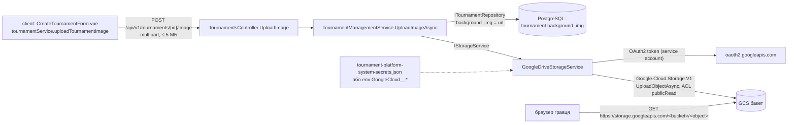

# Legacy: сховище банерів (`GoogleDriveStorageService`)

Компонент обрано як найгірше документований (ЛР-10/12): до цього документа він згадувався лише одним рядком у [SDD](../sdd.md) («Google Cloud Storage — банери турнірів») і в [ISD §4](../isd.md#4-сховища-даних). Немає жодного тесту, жодного опису конфігурації, з травня 2026 код не змінювався (коміт `8d51a23`, 2026-05-05).

Рівні довіри: **[verified]** — перевірено аналізом коду, `grep` або запуском (INC-001); **[assumed]** — гіпотеза, потребує перевірки.

## Граф залежностей



| Твердження | Рівень |
|-----------|--------|
| Єдиний споживач `IStorageService` — `TournamentManagementService.UploadImageAsync`; реєстрація — `AddSingleton<IStorageService, GoogleDriveStorageService>()` у `Program.cs` | verified (`grep -rln IStorageService`) |
| Клієнт викликає upload **після** успішного `POST /tournaments`, у тому самому `try` (`CreateTournamentForm.vue:465–469`) | verified (код) |
| Банери віддаються браузеру напряму з `storage.googleapis.com`, API їх не проксює | verified (формат URL у коді; seed-дані `tournament_theme.image_url`) |

## Конфігурація

```json
{
  "GoogleCloud": {
    "ServiceAccountJson": "<повний JSON ключа сервісного акаунта, рядком>",
    "BucketName": "tournament-zvytiaga-images"
  }
}
```

| Твердження | Рівень |
|-----------|--------|
| Ключі читаються з `IConfiguration`, секції `GoogleCloud`: файл `tournament-platform-system-secrets.json` (поруч із застосунком, `optional: true`) або змінні середовища `GoogleCloud__ServiceAccountJson`, `GoogleCloud__BucketName` | verified (`Program.cs:29–39`, запуск INC-001 через env) |
| `StorageClient` створюється **один раз** у конструкторі singleton; ключ, змінений після старту, не підхоплюється без рестарту | verified (код) |
| Якщо конфігурації немає, сервіс стартує, а кожен upload кидає `ArgumentNullException("Service unavaible. Configuration not provided")`, що перетворюється на 500 | verified (код) |
| Ім'я бакета в проді — `tournament-zvytiaga-images` | verified (URL у seed-даних); актуальність ключа — assumed |
| Для бакета вимкнено uniform bucket-level access (інакше `PredefinedAcl = PublicRead` дасть 400 від GCS) | assumed — перевірити в консолі GCP |

## Ключові методи

| Метод | Призначення | Рівень |
|-------|-------------|--------|
| `GoogleDriveStorageService(IConfiguration)` | будує `GoogleCredential.FromJson` і `StorageClient`; при порожній конфігурації лишає клієнт `null` | verified |
| `UploadAsync(stream, fileName, contentType)` | `UploadObjectAsync` з ACL `publicRead`; повертає `(obj.Name, https://storage.googleapis.com/<bucket>/<name>)`; будь-який виняток обгортає в `Exception("Failedo upload file…: " + ex.Message)` | verified |
| `TournamentManagementService.UploadImageAsync` | перевіряє тип (`jpeg/png/webp`), розмір ≤ 5 МБ, власника турніру; ім'я `tournament_<id>_<guid><ext>`; записує URL у `background_img` | verified |
| Видалення старого банера при заміні | **відсутнє**: старі об'єкти лишаються в бакеті | verified (немає методу delete) |
| `StorageClient` як singleton | спільний на весь процес; потокобезпечність | assumed (документація Google Cloud .NET) |

## Реєстр технічного боргу

| ID | Тип | Опис | Наслідок | Оцінка |
|----|-----|------|----------|--------|
| TD-S1 | code | Будь-яка помилка сховища → `Exception` з текстом SDK → 500 з внутрішнім повідомленням клієнту | інцидент виглядає як баг сервера, не як недоступність залежності; витік деталей (`invalid_grant`, ім'я бакета) | високий (INC-001) |
| TD-S2 | code | Контролер ловить `Exception` і повертає 500 **без логування**; `ExceptionHandlingMiddleware`, який логує, обходиться | 0 записів Error у логах під час INC-001, Loki нічого не бачить | високий |
| TD-S3 | architecture | Неправильна назва: `GoogleDriveStorageService` працює з Cloud Storage; у csproj зайвий пакет `Google.Apis.Drive.v3` (0 використань) | хибний слід під час діагностики; зайва залежність у CVE-скануванні | середній |
| TD-S4 | architecture | Upload — окремий крок після створення турніру, без компенсації | при збої сховища турнір створено без банера; повтор форми → 409 (перевірено, INC-001) | середній |
| TD-S5 | test | 0 тестів на компонент і на шляхи відмови | регресії помилок не ловляться | високий |
| TD-S6 | documentation | Конфігурація, ротація ключа, ACL бакета ніде не описані (до цього документа) | ротація ключа = інцидент | середній |
| TD-S7 | code | Старі банери не видаляються | ріст бакета і витрат | низький |
| TD-S8 | architecture | `/health` не відображає стан сховища, моніторинг — лише агрегатний 5xx | збій непомітний для алертингу (INC-001) | високий |
