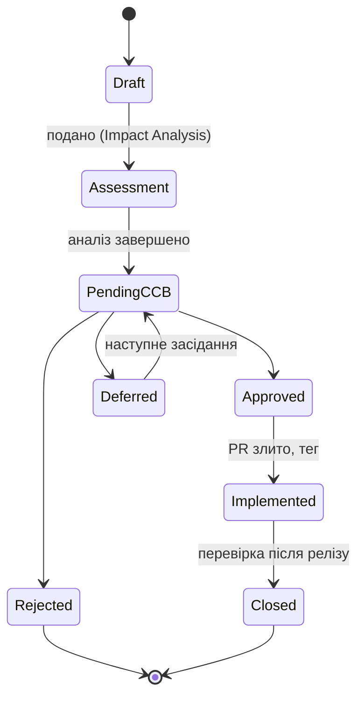

# Управління змінами

Жодна зміна публічної поведінки не потрапляє в `main` без заявки, оцінки впливу, рішення CCB і плану відкату.

## Життєвий цикл RFC

Трекер — GitHub Issues: шаблон `.github/ISSUE_TEMPLATE/rfc.yml`, стан — мітка `rfc:<стан>`, обов'язкове посилання на документ RFC у `docs/changes/`.

## Класи змін (ITIL)

| Клас | Приклад | Хто погоджує |
|------|---------|--------------|
| Стандартна | оновлення patch-версії залежності без зміни API, новий запис у довіднику видів спорту | попередньо погоджена, лише тікет |
| Нормальна | новий/змінений ендпоінт, міграція схеми, зміна конфігурації розгортання | CCB |
| Термінова (emergency) | виправлення SEV-1, безпекова вразливість | eCCB: архітектор + SRE, протокол постфактум протягом 2 робочих днів |

## Оцінка ризику

Risk Exposure = ймовірність збою (1–5) × наслідки (1–5). ≤ 4 — низький, 5–9 — середній, ≥ 10 — високий (лише з планом відкату, перевіреним на staging, і не під час обмеження бюджету помилок).

## Регламент CCB

- **Склад і кворум:** архітектор (технічна цілісність), лідер QA (регресійний ризик), представник SRE (експлуатація), продуктовий власник (цінність і терміни). Кворум — 3 з 4, обов'язково SRE для змін з міграціями.
- **Періодичність:** щотижня, вівторок 10:00 UTC; позачергово — eCCB для термінових змін.
- **Подання:** RFC у стані `Assessment` з повною Impact Analysis і планом відкату не пізніше ніж за 24 год до засідання.
- **Рішення:** погоджено / погоджено з умовами / відхилено / відкладено; фіксується протоколом у `docs/changes/`.
- **Change freeze:** коли бюджет помилок будь-якого SLO з [`slo.yaml`](https://github.com/serskurtul/Tournament-Platform-System/blob/main/docs/slo.yaml) вичерпано, CCB погоджує лише зміни надійності, CAPA і термінові; при витраті ≥ 75% — нові зміни з Risk Exposure ≥ 10 відкладаються.

## Реєстр

| RFC | Зміна | Клас | Risk Exposure | Стан |
|-----|-------|------|---------------|------|
| [RFC-001](RFC-001.md) | Реальний профіль у `GET /api/v1/users/me` замість заглушки | нормальна | 6 (середній) | Implemented (`c3ace09`, реліз v1.3.0) |

Протоколи: [CCB 2026-11-22](ccb-2026-11-22.md). Готовність релізу: [Release Checklist v1.3.0](release-checklist.md).
