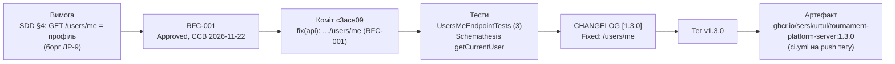

# Release Checklist (go/no-go): v1.3.0

Реліз містить [RFC-001](RFC-001.md) (`/users/me`), CAPA [INC-001](../incidents/INC-001-postmortem.md), виправлення контрактних дефектів ЛР-11 і експлуатаційний пакет ЛР-12. Протокол перевірок: `docs/quality-labs/lab12/evidence/release-v1.3.0-checks.txt` (2026-11-22, коміт `994a72e`).

## Критерії

| # | Критерій | Як перевірено | Стан |
|---|----------|---------------|------|
| 1 | Тести зелені | `dotnet test server/Tests` — 53/53; клієнт `npm run lint && npm run build` | ✅ GO |
| 2 | Контракт відповідає коду | Spectral 0 errors; Schemathesis 5/5 операцій; `doc_contract_check.py` PASS | ✅ GO |
| 3 | Міграції перевірені на staging | з v1.2.0 змін у `Migrations/` немає (0 файлів) — нема що перевіряти; умова CCB «реліз без міграцій» виконана | ✅ GO |
| 4 | Розгортання на staging | `helm lint` (prod values) OK; **розгортання на minikube/staging не виконано** — у середовищі підготовки релізу немає кластера | ⏳ **перед виходом**: `helm upgrade --install … -f values-minikube.yaml`, `helm test`, smoke `/health`, `/api/v1/users/me` |
| 5 | Документація і CHANGELOG (DoD ЛР-11) | `CHANGELOG.md` [1.3.0]; `openapi.yaml` 1.2.0; SDD/ISD оновлено; `mkdocs build --strict` exit 0; `review_date` PASS | ✅ GO |
| 6 | Моніторинг і алерти | 5 правил у `prometheusrule.yaml` з `runbook_url`; `TournamentBannerUploadFailing` перевірено на симуляції (FIRING); `slo.yaml` валідний | ✅ GO (у кластері — після кроку 4: `kubectl get prometheusrule`) |
| 7 | Runbook відкату під рукою | ISD §7.1: `helm rollback`; RFC-001 «План відкату»; RB-001 для даних. Позапланова копія БД перед релізом (ISD §7.2, крок 2) | ✅ GO |
| 8 | Бюджет помилок дозволяє реліз | витрат за 30 днів у продакшн-середовищі немає (моніторинг ще не розгорнуто) → freeze не діє | ✅ GO |
| 9 | Комунікація | запис у CHANGELOG; повідомлення організаторам про відновлення сесії (`/users/me`) і про те, що збій банера більше не блокує створення турніру | ⏳ підготувати текст перед виходом |

**Рішення:** **GO з умовою** — після кроків 4 і 9 (виконує власник релізу в кластері).

## Ланцюг простежуваності

| Ланка | Артефакт |
|-------|----------|
| Вимога | [SDD §4](../architecture/sdd.md), рядок `GET /api/v1/users/me` |
| RFC | [RFC-001](RFC-001.md), протокол [CCB 2026-11-22](ccb-2026-11-22.md) |
| Коміти | `42e2cba` (RFC, CCB), `c3ace09` (реалізація, контракт 1.2.0) |
| Тести | `server/Tests/UsersMeEndpointTests.cs`, операція `getCurrentUser` у контрактному тесті |
| CHANGELOG | розділ `[1.3.0]` → *Fixed* |
| Тег | `v1.3.0` |
| Артефакт | образи `tournament-platform-{server,client}:1.3.0` у GHCR (публікує `ci.yml` при push тегу) |

Після релізу: 15 хв спостереження за 5xx (умова CCB) → RFC-001 у стан **Closed**.
