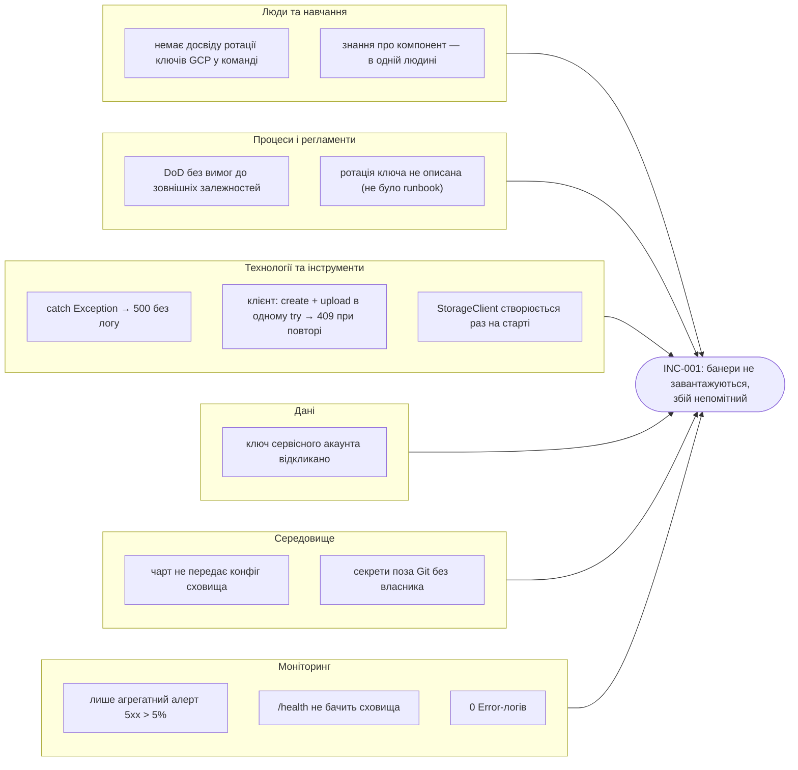

# Post-Mortem INC-001: відмова завантаження банерів

**Формат — blameless.** Аналізуються система і процеси, а не люди: покарання за чесний звіт гарантує, що наступний звіт буде неправдивим. Хронологія й вплив — у [Incident Report](INC-001.md).

## Підсумок

Сховище банерів відхилило ключ сервісного акаунта (`invalid_grant`). 12 із 12 завантажень завершилися 500 з внутрішнім повідомленням SDK. `/health` лишався 200, агрегатний алерт мовчав (1,49% < 5%), а в логах не було жодного запису рівня Error. Організатор бачив «Server error», хоча турнір уже створено, і повторна відправка форми давала 409.

## Що спрацювало добре

- Метрики з міткою `route` (шаблон маршруту) дозволили за секунди локалізувати збій до одного ендпоінта.
- SLI `banner-upload`, доданий у `slo.yaml` перед інцидентом, одразу показав повне порушення (0%).
- Поле банера необов'язкове: обхід «без банера» існував без змін у коді.

## Аналіз першопричин: «5 Чому»

| # | Питання | Відповідь | Доказ |
|---|---------|-----------|-------|
| 1 | Чому організатори не отримали банери? | `UploadAsync` отримав від Google `invalid_grant` (ключ невідомий/відкликаний), і кожен запит завершився 500 | тіло відповіді 500 (`evidence/incident-simulation-FAIL.txt`), `GoogleDriveStorageService.UploadAsync` |
| 2 | Чому відмову залежності ніхто не помітив, поки не поскаржився користувач? | Єдиний алерт — частка 5xx по всьому API > 5%; upload — 1,5% трафіку, тож навіть 100% відмов дають 1,49%. `/health` перевіряє лише БД | вивід симуляції (`NOT FIRING`), `prometheusrule.yaml` (ЛР-7: одне правило), `HealthHandler.cs` |
| 3 | Чому черговий не побачив причини в логах? | `TournamentsController.UploadImage` ловить `Exception` і сам повертає 500 **без логування**, тож `ExceptionHandlingMiddleware`, який логує, не задіяний | `grep -c '"level":"Error"' api.log` = 0 (`evidence/incident-api-log.txt`); `catch (Exception ex)` у `UploadImage` (до CA-1) |
| 4 | Чому обробка і моніторинг залежності виявилися такими? | Компонент створено одним комітом (`8d51a23`, 2026-05-05) без тестів шляхів відмови, без опису конфігурації й без SLI. Чарт Kubernetes навіть не передавав його конфігурацію | `git log --follow GoogleDriveStorageService.cs`; 0 тестів (`grep -rln Storage server/Tests` — лише `obj/`); `grep GoogleCloud charts/` — 0 збігів до PA-1 |
| 5 | Чому процес дозволив злити й розгорнути зовнішню залежність без цього? | **Definition of Done і чек-лист PR не містять вимог до зовнішніх залежностей** (тест відмови, мапінг на 503 + лог, SLI/алерт, конфігурація в усіх середовищах, runbook). Каталог алертів будувався від загального SLO, а не від критичних шляхів запису | `.github/PULL_REQUEST_TEMPLATE.md` і `docs/developer/contributing.md` до PA-1; [каталог алертів](../runbooks/alerts.md) до CA-2 |

**Коренева причина (процесна):** процес розробки й експлуатації не вимагав проєктувати, тестувати й спостерігати режими відмови зовнішніх залежностей. Тому збій сховища одночасно став 500-м «багом сервера», невидимим для алертингу й логів. Ключ, відкликаний у GCP, — лише тригер.

## Діаграма Ісікави

Гіпотези, підтверджені доказами: R1, R2, T1, T2, T3, D1, E1, M1, M2, M3 (див. «5 Чому» і [legacy-документ](../architecture/legacy/storage-service.md)). P1, P2, E2 — assumed (організаційні, не перевірялись).

## План CAPA

| ID | Тип | Опис | Власник | Дедлайн | Статус | Перевірка ефективності |
|----|-----|------|---------|---------|--------|------------------------|
| **CA-1** | коригувальна | Відмова сховища → `StorageUnavailableException` → **503** `StorageUnavailable` з нейтральним текстом; `LogError` з `traceId` і вкладеним винятком; клієнт показує «турнір створено, банер — пізніше» замість помилки створення (без 409 при повторі). Тести: `BannerStorageFailureTests` (2) | Скуртул С. | 2026-11-22 | **Done** | Повтор симуляції тим самим ключем (`evidence/incident-simulation-PASS.txt`): 12/12 → 503 без `invalid_grant` у тілі; 12 рядків Error у лозі. Повторна перевірка: щомісячний restore/chaos drill — 0 відповідей 500 на upload при недоступному сховищі |
| **CA-2** | коригувальна | Окремий алерт `TournamentBannerUploadFailing` (> 50% 5xx на маршруті за 15 хв, ≥ 3 спроби, `for: 5m`) з runbook [RB-002](../runbooks/RB-002.md) (діагностика за вкладеним винятком, ротація ключа) | Скуртул С. | 2026-11-22 | **Done** | Той самий прогін: правило обчислене на метриках → `FIRING` (100%, 12 спроб), тоді як агрегатний алерт — `NOT FIRING`. У кластері — `kubectl get prometheusrule` містить правило; тест: вимкнути секрет на staging, алерт у Alertmanager ≤ 20 хв |
| **PA-1** | попереджувальна | (а) Чарт передає конфіг сховища (`storage.existingSecret`, `GoogleCloud__*`); до цього **у кожному K8s-середовищі** upload гарантовано падав — потенційний SEV-3, виявлений RCA. (б) У DoD і PR-шаблон додано пункт «зовнішня залежність»: тест шляху відмови, 503 + лог, SLI/алерт, конфіг в усіх середовищах, runbook | Скуртул С. | 2026-12-15 (аудит) | **Implemented, перевірка відкрита** | `helm template --set storage.existingSecret=…` рендерить обидві змінні (перевірено). До 2026-12-15: аудит усіх адаптерів зовнішніх сервісів (зараз 1 — GCS) за чек-листом — 0 невідповідностей; кожен наступний PR з новою залежністю проходить пункт DoD (перевіряє CCB) |

## Уроки

1. Агрегатні SLI приховують відмову рідкісних, але важливих шляхів запису: критичний шлях отримує власний SLI й алерт.
2. Залежність, якої немає в `/health`, має давати зрозумілий 503 і рядок Error, інакше черговий діагностує наосліп.
3. Багатокрокова операція в UI (створити → завантажити) повинна розрізняти «не створено» і «створено частково».
