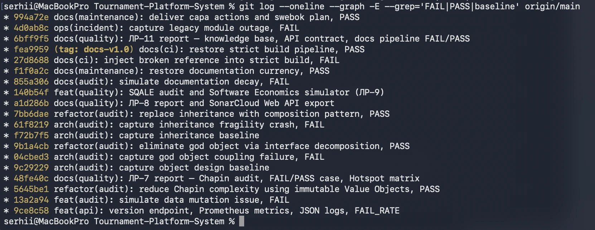
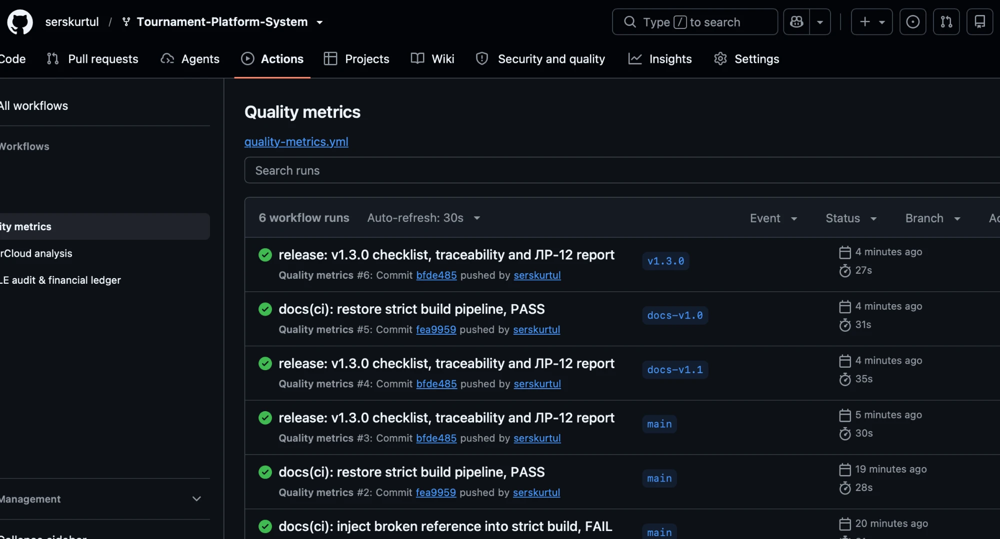

# ЛР-7. Інформаційна складність за Чепіним та Hotspots у CI/CD

Проєкт: ZVYTIAHA (ASP.NET Core 9 API + Vue 3), репозиторій `serskurtul/Tournament-Platform-System`.

## 1. Декларація об'єкта аналізу

| Параметр | Значення |
|----------|----------|
| Метод | `JwtTokenService.GenerateToken(Guid userId, string email, string role, bool isOrganizer)` |
| Файл | `server/TournamentPlatformSystemWebApi.Infrastructure/Security/JwtTokenService.cs` |
| Архітектурна роль | Інтеграційний контур автентифікації: видає підписані JWT для входу, реєстрації та оновлення сесії (`AuthenticationService.LoginAsync / RegisterAsync / RefreshAsync`). Від повернутого `ExpiresAt` залежать cookie і логіка refresh на клієнті. |
| Цикломатична складність (Мак-Кейб, Lizard 1.26.1) | **CCN = 3** (1 + два оператори `??`), тобто метод лінійний |
| Чому саме він | Низька CC, але інтенсивна робота з даними: 4 аргументи, 9 проміжних локальних об'єктів, читання конфігурації, мапування в claims |

## 2. Семантична матриця Чепіна (до рефакторингу)

Правило пріоритету для змінних з кількома ролями: C > M > P > T.

| Змінна | Тип даних | Клас | Інженерне обґрунтування | Вага |
|--------|-----------|:----:|-------------------------|-----:|
| `_options.Key` | `string?` | C | Перевіряється оператором `??` на `null`: вирішує, яким ключем підписувати | 3 |
| `_options.Issuer` | `string?` | C | Перевіряється `??`: вирішує емітента/аудиторію токена | 3 |
| `userId` | `Guid` | P | Лише читається й перетворюється в рядок для claim `sub` | 1 |
| `isOrganizer` | `bool` | P | Лише читається й перетворюється (`ToString`) для claim | 1 |
| `_options.ExpirationMinutes` | `int` | P | Конфігурація, лише читається для обчислення терміну | 1 |
| `key` | `string` | M | Мутабельна локальна `var`, обчислюється з умовного виразу | 2 |
| `issuer` | `string` | M | Мутабельна локальна `var`, обчислюється з умовного виразу | 2 |
| `securityKey` | `SymmetricSecurityKey` | M | Створюється всередині з `key` | 2 |
| `credentials` | `SigningCredentials` | M | Створюється всередині з `securityKey` | 2 |
| `jwtId` | `string` | M | Генерується всередині, використовується в claim і в результаті | 2 |
| `expiresAt` | `DateTime` | M | Обчислюється всередині; потрапляє і в токен, і в результат (саме її перезапис дав FAIL) | 2 |
| `claims` | `Claim[]` | M | Мутабельний масив (елементи можна замінити) | 2 |
| `token` | `JwtSecurityToken` | M | Створюється з усіх попередніх значень | 2 |
| `tokenString` | `string` | M | Результат серіалізації токена | 2 |
| `email` | `string` | T | Без змін прокидається в `new Claim(...)` | 0.5 |
| `role` | `string` | T | Без змін прокидається в `new Claim(...)` | 0.5 |

Підсумок: P = 3, M = 9, C = 2, T = 2.

**Розрахунок:** Cch = 1·P + 2·M + 3·C + 0.5·T = 1·3 + 2·9 + 3·2 + 0.5·2 = 3 + 18 + 6 + 1 = **28**.

**Висновок:** 28 > 10, тобто для лінійного методу це індикатор хаосу в даних. Дев'ять мутабельних проміжних станів означають дев'ять місць, де випадковий перезапис змінить або токен, або значення, яке бачить клієнт, і Мак-Кейб (CCN = 3) цього ризику не показує.

## 3. Симуляція збою (FAIL)

**Сценарій.** Після побудови токена мутабельна змінна `expiresAt` випадково змінюється вдруге (типовий copy-paste дефект):

```csharp
var token = new JwtSecurityToken(issuer: issuer, audience: issuer, claims: claims,
                                 expires: expiresAt, signingCredentials: credentials);

// ЛР-7 FAIL simulation: the mutable local `expiresAt` is accidentally adjusted a second time
expiresAt = expiresAt.AddMinutes(_options.ExpirationMinutes);

var tokenString = new JwtSecurityTokenHandler().WriteToken(token);
return (tokenString, jwtId, expiresAt);
```

**Невалідний бізнес-результат.** Токен підписаний зі старим `exp`, а викликачі отримують `ExpiresAt` на ще один термін пізніше. Клієнт вважає сесію живою, коли сервер уже відхиляє токен, і користувач отримує «раптові» 401 замість планового refresh.

**Тест**, який це ловить (`server/Tests/JwtTokenServiceTests.cs`):

```csharp
[Fact]
public void GenerateToken_ReturnedExpiry_MatchesTokenExpClaim()
{
    var svc = new JwtTokenService(new JwtTokenOptions("expiry-consistency-key-long-enough-1234567890", "test-issuer", 15));
    var (tokenString, _, expiresAt) = svc.GenerateToken(Guid.NewGuid(), "e@x.com", "player", false);
    var tokenExpiry = new JwtSecurityTokenHandler().ReadJwtToken(tokenString).ValidTo;
    Assert.InRange((expiresAt - tokenExpiry).Duration().TotalSeconds, 0, 1);
}
```

**Зафіксований результат** (повний вивід: [evidence/01-fail-mutation-test.txt](evidence/01-fail-mutation-test.txt)):

```
Failed Tests.JwtTokenServiceTests.GenerateToken_ReturnedExpiry_MatchesTokenExpClaim
Assert.InRange() Failure: Value not in range
Actual: 900.80841459999999        ← повернутий ExpiresAt на 15 хв пізніший за exp токена
Failed!  - Failed: 1, Passed: 5, Total: 6
```

Коміт стану: `13a2a94 feat(audit): simulate data mutation issue, FAIL`.

## 4. Архітектурний кейс «Очищення від хаосу змінних» (PASS)

### Що зроблено

- **Імутабельність.** У методі не лишилось жодної мутабельної локальної змінної. Поля сервісу `readonly`. Значення, які раніше перезаписувались (`jwtId`, `expiresAt`), живуть лише в незмінному record `TokenEnvelope`, і з нього ж беруться і для токена, і для результату. Розходження більше неможливе конструктивно.
- **Value Objects** (`server/.../Infrastructure/Security/`):
  - `AccessTokenSubject` (record): чотири розрізнені аргументи `userId, email, role, isOrganizer` в одному незмінному об'єкті, який сам будує claims (`ToClaims`).
  - `JwtSigningSettings`: розв'язана конфігурація підпису. Fallback-и `??` (колишні керуючі змінні C) виконуються **один раз при старті** у `From(...)`, а не при кожній видачі токена.
  - `IssuedAccessToken` (record): токен разом з точним `ExpiresAt`, підписаним у нього.
- **`TimeProvider`** замість `DateTime.UtcNow`: час береться один раз, і метод можна тестувати з фіксованим годинником.

### Код «До / Після»

До (`40f5e6b`, 30 рядків тіла, 9 мутабельних локалів):

```csharp
public (string Token, string JwtId, DateTime ExpiresAt) GenerateToken(Guid userId, string email, string role, bool isOrganizer)
{
    var key = _options.Key ?? "default-development-key-change-in-production";
    var issuer = _options.Issuer ?? "tournament-api";
    var securityKey = new SymmetricSecurityKey(Encoding.UTF8.GetBytes(key));
    var credentials = new SigningCredentials(securityKey, SecurityAlgorithms.HmacSha256);
    var jwtId = Guid.NewGuid().ToString();
    var expiresAt = DateTime.UtcNow.AddMinutes(_options.ExpirationMinutes);
    var claims = new[] { /* sub, jti, email, role, isOrganizer */ };
    var token = new JwtSecurityToken(issuer: issuer, audience: issuer, claims: claims,
                                     expires: expiresAt, signingCredentials: credentials);
    var tokenString = new JwtSecurityTokenHandler().WriteToken(token);
    return (tokenString, jwtId, expiresAt);
}
```

Після:

```csharp
public (string Token, string JwtId, DateTime ExpiresAt) GenerateToken(Guid userId, string email, string role, bool isOrganizer)
{
    var issued = _signing.Issue(new AccessTokenSubject(userId, email, role, isOrganizer), _clock.GetUtcNow());
    return (issued.Token, issued.JwtId, issued.ExpiresAt);
}

// JwtSigningSettings
public IssuedAccessToken Issue(AccessTokenSubject subject, DateTimeOffset now) =>
    Sign(subject, new TokenEnvelope(Guid.NewGuid().ToString(), now.UtcDateTime + Lifetime));

private IssuedAccessToken Sign(AccessTokenSubject subject, TokenEnvelope envelope) => new(
    Handler.WriteToken(new JwtSecurityToken(issuer: Issuer, audience: Issuer,
        claims: subject.ToClaims(envelope.JwtId), expires: envelope.ExpiresAt, signingCredentials: Credentials)),
    envelope.JwtId,
    envelope.ExpiresAt);

private sealed record TokenEnvelope(string JwtId, DateTime ExpiresAt);
```

### Нова матриця Чепіна (PASS)

| Змінна | Тип даних | Клас | Інженерне обґрунтування | Вага |
|--------|-----------|:----:|-------------------------|-----:|
| `_signing` | `JwtSigningSettings` (readonly, immutable) | P | Лише читається: викликається `Issue` | 1 |
| `_clock` | `TimeProvider` (readonly) | P | Лише читається: `GetUtcNow()` | 1 |
| `issued` | `IssuedAccessToken` (immutable record) | P | Лише читаються три властивості | 1 |
| `userId` | `Guid` | T | Без змін передається в `AccessTokenSubject` | 0.5 |
| `email` | `string` | T | Без змін передається в `AccessTokenSubject` | 0.5 |
| `role` | `string` | T | Без змін передається в `AccessTokenSubject` | 0.5 |
| `isOrganizer` | `bool` | T | Без змін передається в `AccessTokenSubject` | 0.5 |

P = 3, M = 0, C = 0, T = 4.

**Розрахунок:** Cch = 1·3 + 2·0 + 3·0 + 0.5·4 = 3 + 2 = **5**.

**Порівняння:** 28 → 5, падіння в **5.6 раза** (вимога: щонайменше вдвічі й Cch ≤ 6, виконано). Мак-Кейб: CCN 3 → 1.

Куди поділась складність. Fallback-и конфігурації (дві колишні змінні C) перенесено в `JwtSigningSettings.From`, який виконується один раз при старті. Це єдине місце з CCN = 3 у новому коді. У `Issue`/`Sign` немає жодної мутабельної змінної: усі значення — параметри або незмінні record-и (`now`, `Lifetime`, `TokenEnvelope`), CCN = 1.

### Підтвердження PASS

Усі 45 юніт-тестів проходять, зокрема тест з FAIL і новий тест з фіксованим годинником (`GenerateToken_WithFixedClock_ExpiryIsNowPlusLifetimeExactly`: `ExpiresAt == now + 10 хв` і дорівнює `exp` у токені). Вивід: [evidence/02-pass-tests.txt](evidence/02-pass-tests.txt).

Коміт стану: `refactor(audit): reduce Chapin complexity using immutable Value Objects, PASS`.

### Git History

```
ci(quality): complexity scan, churn and Hotspot matrix artifact
refactor(audit): reduce Chapin complexity using immutable Value Objects, PASS
feat(audit): simulate data mutation issue, FAIL
```



*`git log --oneline --graph -E --grep='FAIL|PASS|baseline' origin/main` у форку: для ЛР-7 — `13a2a94 … FAIL` → `5645be1 … PASS` (унизу).*

## 5. Код автоматизації CI/CD

Файл: [`.github/workflows/quality-metrics.yml`](../../../.github/workflows/quality-metrics.yml). На кожен push і pull request у Docker-контейнері `python:3.12-bookworm` на хмарному раннері GitHub Actions:

1. ставить сканер `lizard==1.26.1`;
2. сканує C#, TypeScript, JavaScript і Vue (без міграцій і тестів) у CSV;
3. рахує churn (`git log --name-only`) за всю історію і за 90 днів;
4. будує матрицю Hotspots скриптом [`scripts/quality/hotspot_matrix.py`](../../../scripts/quality/hotspot_matrix.py) у JSON, CSV і Markdown;
5. публікує теку `quality-report/` як артефакт збірки `quality-report` і виводить матрицю в Job Summary.

Локальний прогін усіх кроків пройшов: 432 функції, 110 файлів, артефакт містить `lizard.csv`, `churn-*.txt`, `*/complexity.json`, `*/hotspots.{json,csv,md}`.



*Actions → Quality metrics: усі прогони зелені (push у `main` і теги). Артефакт `quality-report` — у кожному run, розділ Artifacts.*

## 6. Лог метрик процесу (Churn Rate)

Команда з методички (повний вивід: [evidence/03-churn-git-log.txt](evidence/03-churn-git-log.txt)):

```
$ git log --format=format: --name-only | egrep -v '^$' | sort | uniq -c | sort -nr | head
     27 server/TournamentPlatformSystemWebApi.Infrastructure/Services/TournamentService.cs
     21 server/TournamentPlatformSystemWebApi.API/Program.cs
     21 server/TournamentPlatformSystemWebApi.API/Controllers/TournamentsController.cs
     19 client/src/components/dashboard/RoleDashboard.vue
     16 client/src/services/tournamentService.ts
     16 client/src/services/authService.ts
     16 README.md
```

Вікно аналізу. Основна розробка йшла з 06.03.2026 по червень 2026, а за останні 90 днів лише 18 комітів (переважно DevOps-лаби). Тому матрицю побудовано за **повною історією семестру** (Варіант 1, «Ретроспективний аудит», 385 комітів до коміту ЛР-7). 90-денний зріз CI теж будує окремо (`quality-report/last-90-days`).

> Примітка: локальний клон спершу був shallow (обрізана історія), і перші цифри були занижені. Після `git fetch --unshallow` дані перераховано. У CI це не проблема: workflow бере повну історію (`fetch-depth: 0`).

## 7. Синергетична матриця Hotspots

Пороги: висока складність = max CCN функції у файлі > 10 (за методичкою); висока мінливість = ≥ 6 комітів (75-й перцентиль churn серед 110 проаналізованих файлів, поріг розраховано з даних). Зріз — код на коміті ЛР-7 (до декомпозиції в ЛР-8). Повна матриця на 110 файлів: [evidence/04-hotspots-all-history.md](evidence/04-hotspots-all-history.md).

| Назва файлу | Max CCN | Комітів | Категорія ризику |
|-------------|--------:|--------:|------------------|
| `server/.../Services/TournamentService.cs` | 41 | 27 | **High Risk (Hotspot)** |
| `server/.../Controllers/TournamentsController.cs` | 23 | 21 | **High Risk (Hotspot)** |
| `client/src/components/forms/RegisterForm.vue` | 23 | 13 | **High Risk (Hotspot)** |
| `server/.../Services/AuthenticationService.cs` | 24 | 12 | **High Risk (Hotspot)** |
| `server/.../Core/Logic/SingleEliminationBracketGenerator.cs` | 13 | 5 | Sleeping Danger |
| `client/src/components/forms/LoginForm.vue` | 11 | 5 | Sleeping Danger |
| `client/src/components/dashboard/RoleDashboard.vue` | 5 | 19 | Active Development |
| `client/src/views/TournamentsPage.vue` | 4 | 15 | Active Development |
| `server/.../Services/GoogleDriveStorageService.cs` | 5 | 3 | Stable Code |
| `server/.../Core/Logic/MatchStatusHelper.cs` | 10 | 2 | Stable Code |

Розподіл за всіма 110 файлами: Hotspot 10, Sleeping Danger 3, Active Development 25, Stable Code 72.

### Пріоритети рефакторингу на наступний спринт

1. **`TournamentService.cs`** — головний Hotspot: найвища складність у проєкті (CCN 41) і найчастіше змінюваний файл (27 комітів). Кожна зміна турнірної логіки торкається цього класу, звідси регресії та конфлікти злиття. Кандидат №1 на декомпозицію (ЛР-8, God Object).
2. **`AuthenticationService.cs`** (`RefreshAsync` CCN 24, `RegisterAsync` CCN 22) — безпеково критичний: складність тут напряму означає ризик помилок в автентифікації. Ізоляцію видачі токенів уже почато в цій ЛР.
3. **`TournamentsController.cs`, `RegisterForm.vue`** — Hotspots на межах системи (HTTP API і форма реєстрації). Варто винести валідацію й мапування з контролера та компонента.
4. **Sleeping Danger** (`SingleEliminationBracketGenerator.cs`) — не чіпати без потреби, але покрити тестами перед будь-яким Change Request.
5. **Active Development** (`RoleDashboard.vue`, `TournamentsPage.vue`) — здоровий стан: часто змінюються, але лишаються простими. Стежити, щоб складність не зростала.

## 8. Лог валідації ШІ-Техліда

| Поле | Значення |
|------|----------|
| Дата | 2026-11-22 |
| ШІ-Техлід | Claude (Claude Code), роль — рецензент-екзаменатор |
| Формат | техлід ставить питання по одному; студент відповідає своїми словами без звіту; техлід дає вердикт ✅ / ⚠️ / ❌ і пояснює неточності |
| Контекст | код і звіт ЛР-7 підготовлено з використанням ШІ (Claude Code); краш-тест перевіряє, чи студент розуміє зроблене |

Відповіді студента наведено дослівно.

| # | Питання техліда | Відповідь студента | Вердикт і коментар техліда |
|---|-----------------|--------------------|----------------------------|
| 1 | Поясни інженерний зміст ваг Чепіна: чому C = 3, P = 1, M = 2, T = 0,5? | «взагалі дупля не ріжу про що йде мова» | Студент не орієнтувався в метриці. Техлід пояснив ролі P/M/C/T на змінних методу `GenerateToken` (`userId`, `expiresAt`, `_options.Key`, `email`) і хід ЛР-7 (Q = 28 → FAIL → Q = 5) |
| 1а | (спрощене) Чому змінна C (`_options.Key`) «важча» за T (`email`)? | «бо від C залежить, яким шляхом піде код, а T на сценарії ніяк не впливає» | ✅ Суть правильна. Доповнення: кожна C подвоює кількість сценаріїв і потрібних тестів; T тестів не додає |
| 2 | У рядку `var key = _options.Key ?? "default-key";` чому `_options.Key` = C, а `key` = M? | «бо _options.Key вирішує шлях, а key лише отримує результат» | ✅ Уточнення: `key` — M, бо створюється й присвоюється всередині методу (`var` можна перезаписати); значення, що лише читається ззовні, було б P |
| 3.1 | Чому баг з повторним `expiresAt = expiresAt.AddMinutes(...)` став можливим саме через мутабельність? | «бо якби цю змінну неможливо булоб переприсвоїти, то баг би не зявився, бо цей код би не скомпілювався» | ✅ Відмінно: незмінність переносить виявлення помилки на етап компіляції |
| 3.2 | Як після рефакторингу (PASS) баг стало неможливо повторити? | «бо після рефакторнинга беремо _clock.GetUtcNow()) 1 раз» | ⚠️ Частково. Головне — час закінчення обчислюється один раз у незмінному `IssuedAccessToken`, і те саме значення йде і в токен, і в результат (одне джерело правди). `TimeProvider` додано для тестованості (фіксований годинник у тесті) |
| 4 | Чим твій рефакторинг відрізняється від простого Extract Method (за який дають 1,5 з 4 балів)? | «бо змінні стали незмінними, а не просто перенесені в інший метод» | ✅ Доповнення: налаштування підпису валідуються один раз у `JwtSigningSettings.From`; частина логіки (fallback ключа) переїхала туди, але виконується один раз і тестується окремо — це варто визнати на захисті |
| 5.1 | Чому `SingleEliminationBracketGenerator` (CCN 13, 5 комітів) — Sleeping Danger, а не Hotspot? | «бо в нього мало комітів, його рідко змінюють а ccn високий» | ✅ Hotspot = складність × частота змін; ризик генератора «спить», поки файл не чіпають |
| 5.2 | Що з ним робити і чому не рефакторити першим? | (відповіді не надано) | ❌ Правильно: покрити тестами (є `BracketGeneratorTests`, `SeedingStrategyTests`) і чіпати лише за Change Request; ресурс рефакторингу — на Hotspot `TournamentService`, де кожна зміна дорога вже зараз |

**Підсумок техліда.** Базові поняття засвоєно після пояснення: ролі змінних, зв'язок мутабельності з багом, перевірка компілятором, критерій Hotspot. До захисту повторити: «одне джерело правди» в PASS-рішенні (3.2) і стратегію для Sleeping Danger (5.2).

## Нотатки до захисту (Live Demo)

- **Ваги Чепіна.** T = 0.5: змінна лише транзитом передається далі, на логіку методу не впливає. P = 1: її треба правильно прочитати. M = 2: її стан змінюється, і помилка в будь-якому місці зміни псує результат. C = 3: вона керує гілками виконання, тож помилка змінює саму поведінку методу.
- **Мутабельність і імутабельність.** Мутабельний об'єкт можна змінити після створення (`var x = …; x = …;`, мутабельний масив). Імутабельний фіксується при створенні: `record`, `readonly`-поля, `init`-властивості, а «зміна» означає створення нового об'єкта.
- **Чому Мак-Кейб «сліпий».** CCN рахує лише гілки керування. Метод з 9 мутабельними станами і без жодного `if` має CCN ≈ 1, хоча ризик помилок у ньому високий. Чепін рахує саме дані.
- **Live-демо FAIL → PASS:** `git checkout 13a2a94 && dotnet test server/Tests` дає 1 червоний тест, а `git checkout -` і повторний тест дають усі 45 зелених.
