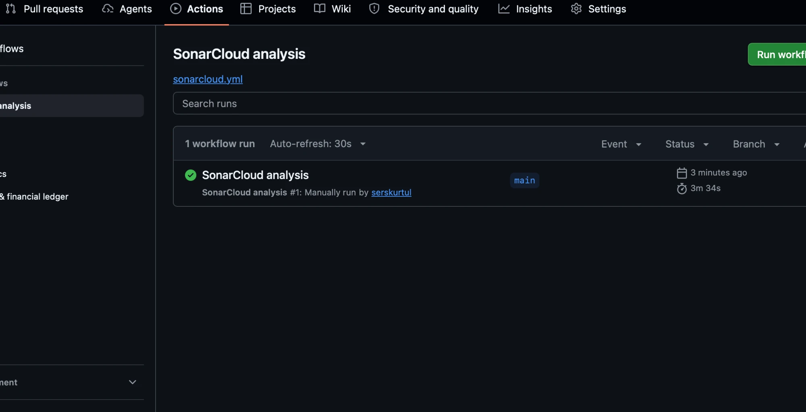
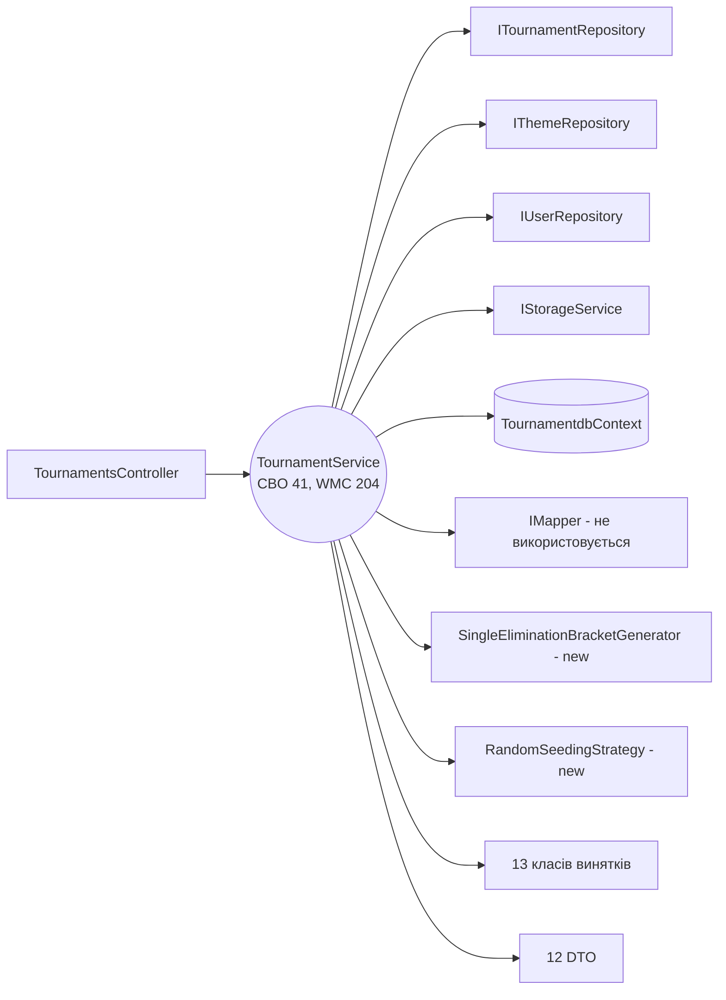
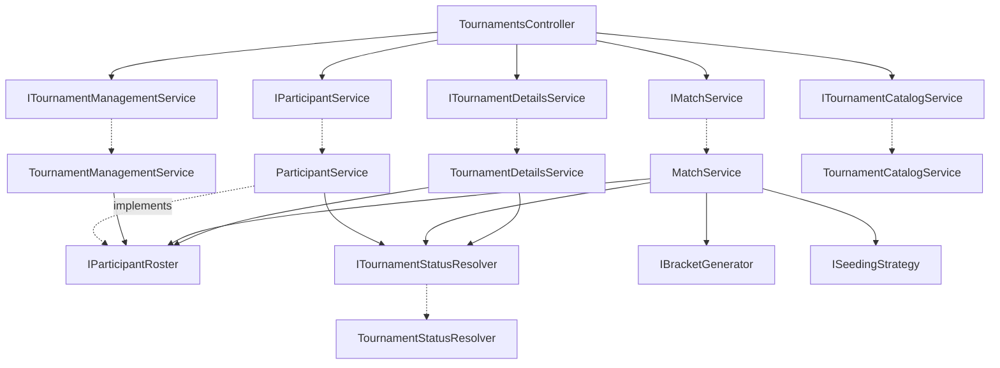
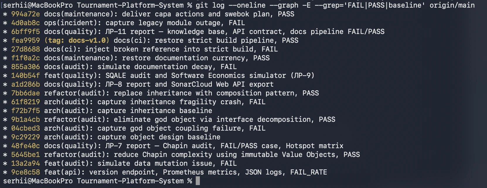

# ЛР-8. ООП-аудит системного дизайну (CK & MOOD), God Object, Inheritance Hell

Проєкт: ZVYTIAHA, бекенд ASP.NET Core 9 (`server/`).

## Інструментарій і важлива примітка про SonarQube

| Що | Чим |
|----|-----|
| Свіжий зріз SonarCloud + вивантаження через Web API | [`.github/workflows/sonarcloud.yml`](../../../.github/workflows/sonarcloud.yml) (SonarScanner for .NET, `begin → build → end`) і [`scripts/quality/sonar_measures.sh`](../../../scripts/quality/sonar_measures.sh) (`curl` → `api/measures/component`, сирий JSON як артефакт) |
| Метрики CK і MOOD | [`tools/CkMetrics`](../../../tools/CkMetrics/Program.cs): власний інструмент на Roslyn (семантичний аналіз компілятора C#), експорт у JSON |

**Чому два інструменти.** Сучасний SonarQube/SonarCloud **не обчислює** для C# метрики пакета CK: `lcom4` і зв'язність класів прибрано ще з SonarQube 4.x, `class_complexity` застарів. Запит з ключами методички (`class_complexity, coupling_between_objects, lcom4`) скрипт виконує навмисно, щоб задокументувати відповідь API. Робочі дані CK (WMC, CBO, LCOM*, LCOM4, DIT, NOC, RFC, PIM, NOO) і MOOD (MHF, AHF, COF) вивантажує `tools/CkMetrics` у той самий машиночитаний JSON. Базова лінія і результати рефакторингу виміряні **одним і тим самим інструментом**.

Визначення в `tools/CkMetrics`:
- **CBO** — кількість інших класів/інтерфейсів *цієї системи*, з якими клас пов'язаний (поля, параметри, локальні змінні, виклики, створення об'єктів, винятки, DTO). Фреймворкові типи рахуються окремо (`CBO_ext`).
- **LCOM\*** — Henderson-Sellers, шкала 0..1 (0 — ідеальна згуртованість). **LCOM4** — кількість зв'язних компонент методів (1 — клас робить одну справу).
- **DIT** рахує `System.Object` (звичайний клас має DIT = 1, як у Visual Studio Code Metrics).

> Аналіз SonarCloud виконано workflow «SonarCloud analysis» (run #1, 2026-11-22, проєкт `serskurtul_Tournament-Platform-System`) на стані `main` після рефакторингу (реліз v1.3.0). Сирі відповіді API — [evidence/sonar-report/](evidence/sonar-report/) (`requests.log` + JSON).



*Actions → SonarCloud analysis #1: зелений run (3 хв 34 с), запущений вручну; артефакт `sonar-report`.*

## Завдання 1. ООП-паспорти та базова лінія

### Декларація API-запитів

```bash
# Ключі методички (документуємо відповідь API)
curl -u $SONAR_TOKEN: "https://sonarcloud.io/api/measures/component?component=<project>:server/TournamentPlatformSystemWebApi.Core/Logic/SingleEliminationBracketGenerator.cs&metricKeys=class_complexity,coupling_between_objects,lcom4"
# Доступні метрики складності для того ж файлу
curl -u $SONAR_TOKEN: "https://sonarcloud.io/api/measures/component?component=<project>:server/TournamentPlatformSystemWebApi.Core/Logic/SingleEliminationBracketGenerator.cs&metricKeys=complexity,cognitive_complexity,functions,classes,ncloc,code_smells"
# ... аналогічно для Infrastructure/Repositories/TournamentRepository.cs та Application/DTOs/TournamentCreateDto.cs
# Рівень проєкту
curl -u $SONAR_TOKEN: "https://sonarcloud.io/api/measures/component?component=<project>&metricKeys=complexity,...,sqale_index,sqale_debt_ratio"
```

### Відповідь SonarCloud API ([evidence/sonar-report/](evidence/sonar-report/))

Запит із ключами методички для всіх трьох файлів → **HTTP 404**, тіло: `{"errors":[{"msg":"The following metric keys are not found: coupling_between_objects"}]}` (`file*-lab-keys.json`). Це документальне підтвердження: SonarCloud не має метрик CBO/LCOM4 для C#, тому CK рахує `tools/CkMetrics`.

| Файл (SonarCloud) | complexity | cognitive | functions | ncloc | code smells | WMC з `tools/CkMetrics` |
|-------------------|-----------:|----------:|----------:|------:|------------:|------------------------:|
| `Core/Logic/SingleEliminationBracketGenerator.cs` | 23 | 18 | 3 | 87 | 4 | **23** |
| `Infrastructure/Repositories/TournamentRepository.cs` | 73 | 55 | 24 | 348 | 8 | **73** |
| `Application/DTOs/TournamentCreateDto.cs` | 16 | 0 | 16 | 26 | 0 | 0 |

Рівень проєкту (`project.json`): ncloc **21 168**, complexity **2 308**, cognitive **1 235**, functions 1 123, classes 169, code smells **81**, дублювання **5,8%**, `sqale_index` **196 хв**, `sqale_debt_ratio` **0,0%** (196 / (21 168 × 30) ≈ 0,03%, округлено).

**Перехресна валідація.** WMC власного Roslyn-інструмента дослівно збігається з `complexity` SonarCloud для класів з логікою (23 = 23, 73 = 73). Отже, CK-таблиці нижче виміряні сумісною з промисловим аналізатором методикою. Розбіжність на DTO методична: SonarCloud рахує кожну автовластивість як функцію зі складністю 1 (16 властивостей → 16), `tools/CkMetrics` вважає автовластивості станом, а не поведінкою (WMC = 0).

Аналогічний виклик інструмента CK:

```bash
dotnet run --project tools/CkMetrics -- server --out ck.json \
  --refs /usr/share/dotnet/shared/Microsoft.AspNetCore.App/9.0.x \
  --refs server/TournamentPlatformSystemWebApi.API/bin/Release/net9.0
```

### Аналітичний JSON-пакет (фрагмент, [evidence/01-ck-baseline.json](evidence/01-ck-baseline.json))

```json
"mood": { "classes": 129, "MHF": 0.144, "AHF": 1, "COF": 0.0163 },
{ "class": "TournamentPlatformSystemWebApi.Infrastructure.Services.TournamentService",
  "file": "TournamentPlatformSystemWebApi.Infrastructure/Services/TournamentService.cs",
  "WMC": 204, "CBO": 41, "CBO_ext": 45, "LCOM": 0.824, "LCOM4": 1, "DIT": 1, "NOC": 0,
  "RFC": 88, "PIM": 17, "NOO": 0, "methods": 21, "fields": 6 }
```

### Зведена таблиця CK & MOOD (базова лінія)

| Файл (роль) | WMC | CBO | LCOM* | LCOM4 | DIT | RFC |
|-------------|----:|----:|------:|------:|----:|----:|
| `Core/Logic/SingleEliminationBracketGenerator.cs` (Core Domain) | 23 | 4 | 0 | 1 | 1 | 7 |
| `Infrastructure/Repositories/TournamentRepository.cs` (Infrastructure) | 68 | 15 | 0 | 18* | 2 | 51 |
| `Application/DTOs/TournamentCreateDto.cs` (DTO) | 0 | 0 | 0 | 0 | 1 | 0 |
| **`Infrastructure/Services/TournamentService.cs`** (епіцентр) | **204** | **41** | **0.824** | 1 | 1 | **88** |

\* `TournamentRepository` працює з **успадкованими** `protected`-полями бази, а LCOM рахує лише власні поля класу, тому 18 «розірваних» компонент — артефакт вертикальної залежності, а не реальна картина (див. Завдання 3).

| MOOD (уся система, 129 класів) | Значення | Тлумачення |
|--------------------------------|---------:|------------|
| MHF (приховування методів) | 0.144 | Лише 14% методів непублічні: публічний інтерфейс класів широкий |
| AHF (приховування атрибутів) | 1.00 | Усі явні поля приватні, стан доступний через властивості |
| COF (коефіцієнт зачеплення) | 0.0163 | Низький у середньому, але розподіл нерівномірний: кілька класів зібрали більшість зв'язків |

### Первинний архітектурний вердикт

Дизайн загалом неоднорідний. Доменне ядро (`Core/Logic`) і DTO мають низьку складність і слабке зачеплення, тобто здорові. Але `TournamentService` — **клас-мутант (God Object)**: 935 рядків, 21 публічний метод з п'яти різних бізнес-областей, CBO = 41 (поріг > 15), LCOM* = 0.82 (наближається до 1), WMC = 204, RFC = 88. Він тягне прямо `TournamentdbContext` в обхід репозиторіїв і має невикористану залежність `IMapper`. Глобальний COF низький, тож «спагеті» немає системно: хаос зосереджено в одному вузлі.

## Завдання 2. Ліквідація God Object

### Епіцентр хаосу (Coupling Matrix)

Дані зв'язності з `coupledTo` у JSON: `TournamentService` пов'язаний з 41 класом системи (репозиторії, DbContext, 13 класів винятків, 12 DTO, доменні сутності й логіка сітки), а його інтерфейс `ITournamentService` — єдина залежність `TournamentsController`.



> **Додати скриншот:** граф залежностей з IDE (Rider/VS Code Dependency Graph) або Dependency Matrix SonarCloud з виділеним `TournamentService`.

Коміт базової лінії: `arch(audit): capture object design baseline`.

### Протокол симуляції збою (FAIL, Shotgun Surgery)

Точкова бізнес-зміна в постачальнику: підрахунок учасників отримує явний параметр.

```csharp
// ITournamentRepository
Task<int> GetParticipantsCountAsync(Guid tournamentId);                            // було
Task<int> GetParticipantsCountAsync(Guid tournamentId, bool includeDisqualified);  // стало
```

Результат ([evidence/02-fail-shotgun-surgery.txt](evidence/02-fail-shotgun-surgery.txt)): **4 помилки компіляції CS7036, усі в `TournamentService.cs`**, у чотирьох незалежних фічах: старт турніру (рядок 202), деталі (445), редагування (502), додавання учасника (614). Одна зміна вимагає правити моноліт у чотирьох різних бізнес-сценаріях.

Коміт: `arch(audit): capture god object coupling failure, FAIL` (збірка навмисно червона).

### Архітектурний Blueprint (PASS)



| Клас | Відповідальність (SRP) |
|------|------------------------|
| `TournamentManagementService` | Створення, чернетка, редагування, банер |
| `ParticipantService` (+ `IParticipantRoster`) | Додавання, видалення, дискваліфікація, список; **єдине** місце, яке рахує активних учасників |
| `MatchService` | Старт (генерація сітки), матчі, результати |
| `TournamentDetailsService` | Деталі турніру і таймлайн подій |
| `TournamentCatalogService` | Списки, пошук, персоналізація |
| `TournamentStatusResolver` | Спільне ядро «турнір з актуальним статусом» |

Усі залежності інжектуються через конструктор і оголошені абстракціями. `MatchService` більше не створює генератор сітки через `new`, а отримує `IBracketGenerator` / `ISeedingStrategy` (вони реєструються як `Transient`, бо стратегія тримає `Random`). Невикористаний `IMapper` прибрано.

**Повторний краш-тест** ([evidence/04-pass-shotgun-retest.txt](evidence/04-pass-shotgun-retest.txt)): та сама зміна сигнатури тепер зачіпає **один рядок в одному класі** (`ParticipantService.CountActiveAsync`). Решта сервісів залежить від контракту `IParticipantRoster`. Збірка зелена, 45/45 тестів.

### Фінальна таблиця CK ([evidence/03-ck-after-decomposition.json](evidence/03-ck-after-decomposition.json))

| Клас | WMC | CBO | LCOM* | LCOM4 | RFC |
|------|----:|----:|------:|------:|----:|
| **До:** `TournamentService` | 204 | 41 | 0.824 | 1 | 88 |
| `TournamentManagementService` | 41 | 13 | 0.667 | 1 | 16 |
| `ParticipantService` | 58 | 16 | 0.625 | 1 | 26 |
| `MatchService` | 63 | 20 | 0.667 | 1 | 16 |
| `TournamentDetailsService` | 12 | **5** | 0.5 | 1 | 7 |
| `TournamentCatalogService` | 30 | 9 | 0.667 | 2 | 42 |
| `TournamentStatusResolver` | 6 | **4** | 0 | 1 | 2 |

**Що доведено:** максимальний CBO 41 → 20 (−51%), WMC 204 → 63 (−69%), RFC 88 → 42 (−52%), LCOM* 0.824 → 0.50…0.67. Shotgun Surgery усунуто.

**Що не досягнуто (чесно):** цільова зона методички «CBO ≤ 8 та LCOM ≤ 0.2 для кожного нового класу» виконана лише для `TournamentDetailsService` і `TournamentStatusResolver`. Причини:
- CBO тут строгий: включає DTO, сутності й класи винятків. Наприклад, у `MatchService` 5 із 20 зв'язків — це доменні винятки (`MatchNotFound`, `MatchNotReady`, …), які є частиною його контракту.
- LCOM* (Henderson-Sellers) для сервісів з DI близький до нуля лише тоді, коли кожен метод використовує майже кожну залежність. З 3–4 класами на домен це недосяжно без подрібнення до класів «один use case — один клас».
- `TournamentCatalogService` має LCOM4 = 2: репозиторні запити і запити через `DbContext` можна розвести ще далі, це наступний крок.

Коміт: `refactor(audit): eliminate god object via interface decomposition, PASS` (стан збірки — PASS, а пороги метрик досягнуто частково, як описано вище).

## Завдання 3. Вертикальний аудит за Лоренцом-Кідом

### Базова лінія ([evidence/05-inheritance-baseline.txt](evidence/05-inheritance-baseline.txt))

Реальна ієрархія проєкту: `BaseRepository<TEntity, TDBEntity>` (5 `virtual`-методів, **`protected`-поля** `_context`, `_mapper`) → `TournamentRepository`, `UserRepository`, `ThemeRepository`.

| Клас-нащадок | DIT | NOO (перевизначені) | PIM | Використань захищених полів бази |
|--------------|----:|--------------------:|----:|---------------------------------:|
| `TournamentRepository` | 2 | 2 (`GetByIdAsync`, `GetAllAsync`) | 16 | 37 |
| `UserRepository` | 2 | 1 (`CreateAsync`) | 13 | 35 |
| `ThemeRepository` | 2 | 0 | 2 | 2 |

DIT = 2 нижчий за орієнтир аномалії методички (≥ 3), і штучно нарощувати ієрархію я не став. Але це класичний **крихкий базовий клас**: нащадки 74 рази залізають у внутрішній стан батька.

Коміт: `arch(audit): capture inheritance baseline`.

### Спадковий краш-тест (FAIL)

Зміна **лише на верхньому рівні**: базовий клас інкапсулює свій стан (правильна з погляду ООП дія).

```csharp
protected readonly TournamentdbContext _context;   →   private readonly TournamentdbContext _context;
protected readonly IMapper _mapper;                →   private readonly IMapper _mapper;
```

Результат ([evidence/06-fail-inheritance-crash.txt](evidence/06-fail-inheritance-crash.txt)): **74 помилки CS0122** каскадом у всіх нащадках (`TournamentRepository` 37, `UserRepository` 35, `ThemeRepository` 2).

Коміт: `arch(audit): capture inheritance fragility crash, FAIL` (збірка навмисно червона).

### Кейс «Успадкування проти Композиції» (PASS)

До:

```csharp
public class TournamentRepository : BaseRepository<Tournament, TournamentModel>, ITournamentRepository
{
    public TournamentRepository(TournamentdbContext context, IMapper mapper) : base(context, mapper) { }

    public override async Task<Tournament?> GetByIdAsync(Guid id) { /* uses base._context, base._mapper */ }
    public override async Task<ICollection<Tournament>> GetAllAsync() { /* ... */ }
    // CreateAsync / UpdateAsync / DeleteAsync inherited
}
```

Після:

```csharp
public class TournamentRepository : ITournamentRepository
{
    private readonly TournamentdbContext _context;
    private readonly IMapper _mapper;
    private readonly BaseRepository<Tournament, TournamentModel> _crud;   // колишній батько = приватне поле

    public TournamentRepository(TournamentdbContext context, IMapper mapper)
        : this(context, mapper, new BaseRepository<Tournament, TournamentModel>(context, mapper)) { }

    public TournamentRepository(TournamentdbContext context, IMapper mapper, BaseRepository<Tournament, TournamentModel> crud)
    { _context = context; _mapper = mapper; _crud = crud; }                // DI через конструктор

    public Task<Guid> CreateAsync(Tournament entity) => _crud.CreateAsync(entity);   // делегування
    public Task<Tournament> UpdateAsync(Tournament entity) => _crud.UpdateAsync(entity);
    public Task<bool> DeleteAsync(Guid id) => _crud.DeleteAsync(id);

    public async Task<Tournament?> GetByIdAsync(Guid id) { /* власна реалізація, без override */ }
    public async Task<ICollection<Tournament>> GetAllAsync() { /* ... */ }
}

public sealed class BaseRepository<TEntity, TDBEntity> : IRepository<TEntity, Guid> { /* private state, no virtual */ }
```

Відкритий generic `BaseRepository<,>` зареєстровано в DI, тож контейнер інжектує помічника в репозиторії. Короткий конструктор лишився для тестів.

### Фінальний аналітичний звіт ([evidence/08-pass-composition-metrics.txt](evidence/08-pass-composition-metrics.txt))

| Клас | DIT | NOO | PIM | LCOM4 |
|------|----:|----:|----:|------:|
| `TournamentRepository` | 2 → **1** | 2 → **0** | 16 → 19 | 18 → 4 |
| `UserRepository` | 2 → **1** | 1 → **0** | 13 → 17 | — → 2 |
| `ThemeRepository` | 2 → **1** | 0 → **0** | 2 → 7 | — → 2 |

Ціль методички (DIT = 1, Overridden = 0) досягнуто для всіх трьох. Зміна з FAIL (приватні поля бази) лишається в коді, а збірка зелена: нащадки більше не бачать внутрішнього стану помічника. Ціна рішення — PIM зростає на делегувальні CRUD-методи. Зате когезія стала вимірюваною: класи володіють своїм станом, і LCOM4 `TournamentRepository` впав з 18 до 4.

Коміт: `refactor(audit): replace inheritance with composition pattern, PASS`.

## Логи Git History

```
refactor(audit): replace inheritance with composition pattern, PASS
arch(audit): capture inheritance fragility crash, FAIL
arch(audit): capture inheritance baseline
refactor(audit): eliminate god object via interface decomposition, PASS
arch(audit): capture god object coupling failure, FAIL
arch(audit): capture object design baseline
```



*Дерево комітів: god object — `9c29229` baseline → `04cbed3` FAIL → `9b1a4cb` PASS; наслідування — `f72b7f5` baseline → `61f8219` FAIL → `7bb6dae` PASS.*

## Лог валідації ШІ-Техліда

> Розділ має містити реальний протокол твого діалогу з ШІ-Техлідом за інструкцією курсу. Його не згенеровано.

## Нотатки до захисту

- **CBO** — зі скількома іншими класами клас пов'язаний. Що більше, то більше причин, з яких його доведеться змінювати (будь-яка зміна сусіда може його зламати).
- **LCOM** — брак згуртованості: чи працюють методи класу з тими самими даними. Висока LCOM означає, що всередині кілька незалежних класів, склеєних разом (як `TournamentService`).
- **God Object** — горизонтальна проблема: один клас знає й робить забагато, звідси Shotgun Surgery. **Inheritance Hell** — вертикальна: нащадки залежать від внутрішнього устрою батька, тож зміна вгорі ламає все, що нижче.
- **Composition over Inheritance**: «є» (is-a) замінюємо на «має» (has-a). Нащадок отримує помічника через конструктор і бачить лише його публічний контракт.
