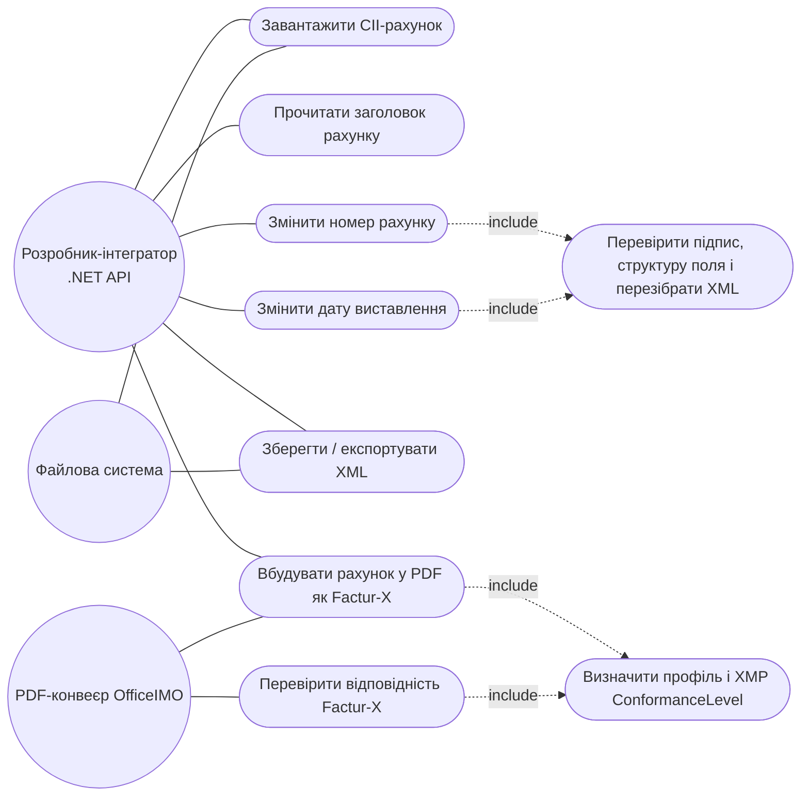

# ЛР-9. SQALE, фінансова капіталізація технічного боргу, FPA & UCP

## Що автоматизовано і що треба запустити

| Завдання | Артефакт | Статус |
|----------|----------|--------|
| 1. SQALE через SonarCloud API | [`.github/workflows/sqale-audit.yml`](../../../.github/workflows/sqale-audit.yml), [`scripts/quality/sqale_audit.py`](../../../scripts/quality/sqale_audit.py) | ✅ Виконано 2026-11-22 для `EvotecIT_OfficeIMO` (коміт workflow `99a2016`) |
| 2. Фінансовий симулятор | [`scripts/quality/financial_simulator.py`](../../../scripts/quality/financial_simulator.py), тести [`scripts/quality/tests/test_lab09.py`](../../../scripts/quality/tests/test_lab09.py) | ✅ [`FINANCIAL_LEDGER.md`](../../../FINANCIAL_LEDGER.md) згенеровано workflow |
| 3. FPA + UCP + калібрування | цей звіт, [`scripts/quality/git_effort.py`](../../../scripts/quality/git_effort.py) | ✅ Модуль «CII e-invoice document» з OfficeIMO; додаток А — той самий метод на модулі автентифікації ZVYTIAHA |

Усі цифри SQALE отримано workflow з публічного API SonarCloud (сирі відповіді — `audit/`), нічого не переписано з сайту вручну.

## Завдання 1. Forensic-аудит SQALE

### Картка об'єкта аудиту

| Поле | Значення |
|------|----------|
| Проєкт | **OfficeIMO** (Evotec) — .NET-бібліотека для створення й читання Word, Excel, PowerPoint, PDF, e-invoice (Factur-X/ZUGFeRD, KSeF) без встановленого Microsoft Office |
| Репозиторій | https://github.com/EvotecIT/OfficeIMO (MIT, ~19 650 комітів, активний: останній коміт 2026-11-22) |
| Project key / organization | `EvotecIT_OfficeIMO` / `evotecit` (поле `organization` з `GET /api/components/show?component=EvotecIT_OfficeIMO`) |
| Стек | C# (збігається зі стеком бекенду ZVYTIAHA) |
| Масштаб | ncloc = **1 288 166** (≥ 50 000 ✔) |

Як обрано: нова сторінка Explore SonarQube Cloud показує лише 5 featured-проєктів без фільтрів (серед них C# — лише SonarLint for VS, 42k рядків, менше порогу). Тому список C#-проєктів з ncloc ≥ 50 000 отримано тим самим публічним API: `GET /api/components/search_projects?filter=languages=cs and ncloc>=50000`. З нього відкинуто студентські репозиторії, форки та не-C# проєкти; лишилися OfficeIMO і nHapi. Обрано OfficeIMO: рукописний C# без генерованого коду, що потрібно для FPA у Завданні 3.

### Протокол хмарного виклику (виконує workflow)

```bash
curl "https://sonarcloud.io/api/measures/component?component=<project_key>&metricKeys=sqale_index,ncloc,sqale_rating"
```

Виконаний запит і HTTP-код ([`audit/request.log`](audit/request.log)):

```text
curl "https://sonarcloud.io/api/measures/component?component=EvotecIT_OfficeIMO&metricKeys=sqale_index,ncloc,sqale_rating"
HTTP 200
```

Сира відповідь ([`audit/report.json`](audit/report.json)):

```json
{"component":{"id":"AZ_cBPPiterwGLJh1T4E","key":"EvotecIT_OfficeIMO","name":"OfficeIMO","qualifier":"TRK","measures":[{"metric":"ncloc","value":"1288166"},{"metric":"sqale_index","value":"484807","bestValue":false},{"metric":"sqale_rating","value":"1.0","bestValue":true}]}}
```

### Математика (`sqale_audit.py`, результат — `audit/SQALE_AUDIT.md`)

| Величина | Формула |
|----------|---------|
| Борг, людино-годин | sqale_index / 60 |
| Борг, робочих днів | години / 8 |
| Обсяг системи, год | ncloc × 30 хв / 60 = ncloc × 0.5 |
| TDD, % | борг у годинах / (ncloc × 0.5) × 100 |
| Рейтинг | A ≤ 5%, B ≤ 10%, C ≤ 20%, D ≤ 50%, E > 50%; `sqale_rating` з API: 1.0 = A … 5.0 = E |

Скрипт сам звіряє розрахований рейтинг з `sqale_rating` із JSON і пише вердикт «збігається / не збігається».

### SQALE Audit Ledger ([`audit/SQALE_AUDIT.md`](audit/SQALE_AUDIT.md))

| Масштаб (ncloc) | Борг, хв | Борг, людино-год | Борг, робочих днів | Обсяг системи, год | TDD | Рейтинг за TDD | `sqale_rating` (API) |
|---:|---:|---:|---:|---:|---:|:---:|:---:|
| 1 288 166 | 484 807 | 8 080,1 | 1 010,0 | 644 083 | **1,25%** | **A** | 1.0 = **A** ✔ |

Перевірка вручну: 484 807 / 60 = 8 080,1 год; / 8 = 1 010 днів; 1 288 166 × 0,5 = 644 083 год; 8 080,1 / 644 083 = 1,254% → A (≤ 5%). Розрахований рейтинг збігається з хмарним.

**Експертний висновок.** Борг OfficeIMO у 1 010 людино-днів виглядає великим лише в абсолютних числах: це 1,25% часу, потрібного, щоб написати систему з нуля. Щільність боргу низька: кодова база з мільйоном рядків утримується в рейтингу A, бо проєкт постійно рефакториться (див. коміти «argument guard migration», «unify lifecycle APIs» в історії модуля Завдання 3). Для порівняння, другий кандидат nHapi (ncloc 2 062 937, sqale_index 4 829 564 хв) має TDD = 80 493 / 1 031 469 = **7,80% → B**: удвічі більша система з удесятеро більшим боргом.

## Завдання 2. Software Economics і Financial Quality Ledger

Скрипт [`financial_simulator.py`](../../../scripts/quality/financial_simulator.py) читає `sqale_index` і `ncloc` **з `report.json`** (нічого не вшито в код) та змінні оточення:

| Змінна | Значення | Перевірка |
|--------|----------|-----------|
| `HOURLY_RATE` | 40 (workflow input) | діапазон 35–50, інакше помилка |
| `OVERLOAD_COEFF` | 1.3 | ≥ 1.0 |
| `DISCOUNT_RATE` | 0.01 (1%/міс) | 0..1 |

Модель:

```
Тіло боргу      = sqale_index / 60 × HOURLY_RATE × OVERLOAD_COEFF
Cost of Delay   = ncloc / 100 × HOURLY_RATE                      (за місяць)
NPV_t           = Σ(k=1..t) CoD / (1 + DISCOUNT_RATE)^k − Тіло боргу,   t = 1..6
Payback         = перший t, де NPV_t > 0;  Quality Gate = PASS, якщо payback ≤ 6, інакше FAIL
```

Ядро циклу:

```python
for t in range(1, HORIZON_MONTHS + 1):
    factor = 1 / (1 + discount_rate) ** t
    benefit = cost_of_delay * factor
    cumulative += benefit
    npv = cumulative - principal
    months.append(Month(t, factor, benefit, npv))
    if npv > 0 and payback is None:
        payback = t
```

`FINANCIAL_LEDGER.md` має п'ять розділів за прикладом з методички: вхідні параметри; тіло боргу і CoD; таблиця «місяць / коефіцієнт дисконтування / дисконтований прибуток / кумулятивний NPV»; вердикт про точку окупності; статус воріт якості PASS/FAIL.

**Тести формул** (синтетичні дані, очікування пораховано вручну): ncloc = 60 000, sqale_index = 120 000 хв, ставка $40, коеф. 1.3, 1%/міс → тіло боргу $104 000, CoD $24 000/міс, NPV₄ < 0, NPV₅ > 0, окупність на 5-му місяці, PASS; для боргу 1 000 000 хв — FAIL. Плюс TDD = 6.67% → B. Усі 6 тестів проходять (`python -m unittest discover -s scripts/quality/tests`); workflow запускає їх перед розрахунком.

### Результат для OfficeIMO ([`FINANCIAL_LEDGER.md`](../../../FINANCIAL_LEDGER.md), консоль — [`audit/simulator-console.log`](audit/simulator-console.log))

| Маркер | Розрахунок | Значення |
|--------|-----------|---------:|
| Тіло боргу | 484 807 / 60 × $40 × 1,3 | **$420 166,07** |
| Cost of Delay | 1 288 166 / 100 × $40 | **$515 266,40 / міс** |

| Місяць | Коефіцієнт | Дисконтований CoD | Кумулятивний NPV |
|---:|---:|---:|---:|
| 1 | 0,9901 | $510 164,75 | **$89 998,69** |
| 2 | 0,9803 | $505 113,62 | $595 112,30 |
| 3 | 0,9706 | $500 112,49 | $1 095 224,79 |
| 4 | 0,9610 | $495 160,88 | $1 590 385,68 |
| 5 | 0,9515 | $490 258,30 | $2 080 643,98 |
| 6 | 0,9420 | $485 404,26 | $2 566 048,23 |

Окупність — **1-й місяць**, Quality Gate **PASS**. Перевірка: 510 164,75 − 420 166,07 = 89 998,68 (розбіжність 1 цент — округлення в таблиці).

> **Додати:** скріншот консолі кроку «Financial simulation» з run workflow «SQALE audit & financial ledger».

### Аналітичний висновок щодо Software Economics

Обидві сторони моделі пропорційні розміру: тіло боргу росте з `sqale_index`, CoD — з `ncloc`. Якщо поділити одне на інше, розмір скорочується:

```
Тіло / CoD = (S/60 × R × 1,3) / (N/100 × R) = 2,167 × S/N
TDD(%)     = (S/60) / (N × 0,5) × 100        = 3,333 × S/N
⇒ Тіло / CoD = 0,65 × TDD(%)   (місяців віддачі без дисконтування)
```

Отже, **швидкість окупності визначає лише щільність боргу (TDD), а не масштаб системи**. Великий масштаб лише множить обидві суми. З дисконтуванням 1%/міс сума шести коефіцієнтів = 5,7955, тож рефакторинг окупається на горизонті 6 місяців тоді й лише тоді, коли 0,65 × TDD < 5,7955, тобто **TDD < 8,92%**: рейтинг A або нижня половина B.

- OfficeIMO: TDD 1,25% → 0,81 місяця CoD → окупність на 1-му місяці (PASS).
- nHapi: TDD 7,80% → 5,07 місяця → кумулятивний коефіцієнт 4,853 після 5-го місяця < 5,07 < 5,7955 після 6-го → окупність на **6-му** місяці, PASS на межі.
- Проєкт з рейтингом C (TDD > 10%) за цією моделлю не окупається за 6 місяців (FAIL): борг треба гасити поетапно, починаючи з Hotspots (ЛР-7), де реальний CoD найвищий.

Критичне зауваження до моделі: CoD = 1 год/міс на 100 рядків не залежить від боргу. Для OfficeIMO вона дає $515 тис./міс втрат, хоча проєкт має рейтинг A, тож це завищення. Модель корисна для порівняння проєктів між собою (через TDD), а не для абсолютного бюджету.

## Завдання 3. FPA (IFPUG) і UCP (Карнер): модуль «CII e-invoice document» з OfficeIMO

**Об'єкт.** Ізольований бізнес-модуль електронних рахунків-фактур (Factur-X / ZUGFeRD, синтаксис UN/CEFACT CII): завантаження XML-рахунку, читання й редагування полів заголовка, вбудовування рахунку в PDF/A-3 з XMP-метаданими та перевірка відповідності профілю. 8 файлів, 522 рядки, стан репозиторію `5c75d8cf8` (2026-11-22):

| Файл | Рядків | Роль |
|------|-------:|------|
| `OfficeIMO.Pdf/Invoices/PdfCiiInvoiceDocument.cs`, `.IO.cs` | 52 + 32 | публічний API документа-рахунку |
| `OfficeIMO.Pdf/Invoices/PdfElectronicInvoiceProfile.cs` | 70 | узгодження XML-профілю й XMP, діагностика Factur-X |
| `OfficeIMO.Pdf/Model/PdfElectronicInvoiceMetadata.cs` | 95 | XMP-метадані e-invoice |
| `OfficeIMO.Pdf/Options/PdfOptions.Invoices.cs` | 21 | `UseFacturXDocument` — вбудувати рахунок у PDF |
| `OfficeIMO.SharedSource/Invoicing/InvoicePreservedXml.cs` | 142 | незмінне сховище XML, читання/редагування полів |
| `…/InvoiceProfileDeclaration.cs`, `InvoiceXml.cs`, `InvoiceSourceFieldException.cs` | 46 + 58 + 6 | визначення профілю, безпечний парсер, помилки |

### Специфікація реверс-інжинірингу (джерела даних)

| Категорія | Джерело в коді |
|-----------|----------------|
| Дані | XML-дерево CII (`InvoicePreservedXml`): поля `InvoiceSourceField` — DocumentId, TypeCode, GuidelineId, CurrencyCode, IssueDate, DueDate, BuyerReference, PaymentReference; ознака `HasXmlSignature`; групи XML: `ExchangedDocument`, `ExchangedDocumentContext`, `ApplicableHeaderTradeSettlement`, `ApplicableHeaderTradeAgreement`. XMP-метадані `PdfElectronicInvoiceMetadata`: DocumentType, DocumentFileName, Version, ConformanceLevel. Довідник профілів `InvoiceProfiles` (guideline id → профіль → XMP ConformanceLevel) — інший модуль, лише читання |
| Транзакції (публічні сигнатури) | `PdfCiiInvoiceDocument.Load(byte[] / Stream / string)`; властивості `DocumentId`, `TypeCode`, `GuidelineId`, `CurrencyCode`, `IssueDate`, `HasXmlSignature`; `WithDocumentId(string)`; `WithIssueDate(DateTime)`; `ToBytes()`, `Save(Stream / string)`; `PdfElectronicInvoiceMetadata(...)`, `FacturX(level, version)`, сеттери; `PdfCreateOptions.UseFacturXDocument(invoice, conformanceLevel, version, …)`; внутрішні `PdfElectronicInvoiceProfile.CreateMetadata / GetDiagnostic / GetRawXmpDiagnostic` |
| Актори | розробник-інтегратор (викликає .NET API), файлова система (читання/запис XML), PDF-конвеєр OfficeIMO (споживає метадані й вкладення) |
| Трудовитрати | Git-історія 8 файлів + 2 колишні шляхи (`OfficeIMO.Invoicing/Xml/InvoiceXml.cs`, `…/Profiles/InvoiceProfileDeclaration.cs`), [evidence/git-effort-officeimo-invoices.txt](evidence/git-effort-officeimo-invoices.txt) |

### UML Use Case діаграма



> Для звіту діаграму можна перемалювати в Draw.io у класичній UML-нотації.

### FPA калькулятор (IFPUG Ledger)

Ваги IFPUG: ILF 7/10/15, EIF 5/7/10, EI 3/4/6, EO 4/5/7, EQ 3/4/6 (Low/Average/High).

| # | Елемент | Тип | RET / FTR | DET | Складність | Вага |
|---|---------|-----|----------:|----:|------------|-----:|
| 1 | CII-рахунок (XML, який модуль зберігає й редагує) | ILF | 4 RET (ExchangedDocument, DocumentContext, HeaderTradeSettlement, HeaderTradeAgreement) | 9 (8 полів + ознака підпису) | Low | 7 |
| 2 | XMP-метадані e-invoice | ILF | 1 RET | 4 | Low | 7 |
| 3 | Довідник профілів e-invoice (`InvoiceProfiles`, лише читання) | EIF | 1 RET | 3 (guideline id, профіль, XMP-рівень) | Low | 5 |
| 4 | Завантажити рахунок (byte[]/Stream/файл — один логічний процес) | EI | 1 FTR | 3 (XML, джерело, ліміти) | Low | 3 |
| 5 | Змінити номер рахунку | EI | 1 FTR | 2 | Low | 3 |
| 6 | Змінити дату виставлення | EI | 1 FTR | 2 | Low | 3 |
| 7 | Створити/змінити XMP-метадані | EI | 1 FTR | 4 | Low | 3 |
| 8 | Вбудувати рахунок у PDF як Factur-X (обчислює ConformanceLevel з профілю) | EO | 3 FTR (рахунок, метадані, довідник) | 6 | Average | 5 |
| 9 | Діагностика відповідності Factur-X (`GetDiagnostic`) | EO | 3 FTR | 5 | Average | 5 |
| 10 | Діагностика XMP-пакета (`GetRawXmpDiagnostic`) | EO | 1 FTR | 4 | Low | 4 |
| 11 | Прочитати заголовок (DocumentId, TypeCode, GuidelineId, CurrencyCode, IssueDate, HasXmlSignature) | EQ | 1 FTR | 6 | Low | 3 |
| 12 | Експортувати XML (`ToBytes` / `Save`) — без перетворень | EQ | 1 FTR | 1 | Low | 3 |
| | **UFP** | | | | | **51** |

Пояснення класифікації: вбудовування й діагностика — EO, а не EQ, бо містять обчислену логіку (профіль → канонічний рівень, перевірка узгодженості XML ↔ XMP). Читання полів і експорт віддають дані без перетворень — EQ. VAF = 1,0 → **FP = 51**.

### UCP матриця Карнера

| Актор | Тип | Вага |
|-------|-----|-----:|
| Розробник-інтегратор (викликає бібліотеку через .NET API) | простий — API | 1 |
| Файлова система (читання/запис XML) | простий — API | 1 |
| PDF-конвеєр OfficeIMO (споживає метадані й вкладення) | простий — API | 1 |
| **UAW** | | **3** |

Модуль — бібліотека без GUI й мережевих протоколів, тому всі актори прості.

| Use Case | Транзакції (кроки з коду) | К-сть | Клас | Вага |
|----------|---------------------------|------:|------|-----:|
| Завантажити рахунок | null/readable → обмежене читання потоку (≤ 16 MiB + 1) → перевірка розміру → копія байтів → парсинг із заборонами DTD/зовнішніх сутностей і лімітами вузлів/атрибутів → перевірка кореня CII/UBL → перевірка `IsCii` | 7 | Середній | 10 |
| Прочитати заголовок | шлях поля за синтаксисом → пошук унікального елемента → відмова при вкладених елементах → для дат: перевірка format 102 → розбір `yyyyMMdd` | 5 | Середній | 10 |
| Змінити номер рахунку | непорожність → ліміт довжини → допустимі XML-символи → відмова для підписаного XML → копія дерева → дозволене поле → пошук існуючого елемента → відмова для структурованого вмісту → заміна → серіалізація UTF-8 → повторне завантаження | 11 | Складний | 15 |
| Змінити дату виставлення | форматування `yyyyMMdd` → відмова для підписаного XML → копія → пошук елемента → перевірка format 102 → заміна → серіалізація → повторне завантаження | 8 | Складний | 15 |
| Зберегти / експортувати XML | guard → захисна копія байтів → запис у потік/файл | 3 | Простий | 5 |
| Вбудувати рахунок у PDF (Factur-X) | guard → байти рахунку → визначення профілю з XML → вимога синтаксису CII → профіль ≠ Peppol → канонічний XMP-рівень → узгодженість із запитаним рівнем → версія = 1.0 → створення метаданих | 9 | Складний | 15 |
| Перевірити відповідність Factur-X | наявність метаданих → DocumentType/FileName/Version → рівно одне вкладення `factur-x.xml` → перерахунок метаданих → канонічне написання рівня → XMP: 4 властивості, скалярні, по одній, без пробілів | 9 | Складний | 15 |
| **UUCW** | | | | **85** |

UUCP = UAW + UUCW = 3 + 85 = **88**; TCF = ECF = 1,0 → **UCP = 88**.

### Зворотне калібрування

Трудовитрати з Git ([evidence/git-effort-officeimo-invoices.txt](evidence/git-effort-officeimo-invoices.txt)): 11 комітів, 2 автори, 2026-06-03 … 2026-11-09. Три коміти, що змінювали лише видалені файли `PdfInvoiceDocument*` (типізовані PDF-рахунки, винесені в окремий адаптер `OfficeIMO.Invoicing.Pdf`), до модуля не належать і виключені.

| Метод | Розрахунок | Людино-годин | PF = год / 88 UCP |
|-------|-----------|-------------:|------------------:|
| Git-hours (сесії ≤ 2 год, +1 год до першого коміту сесії) — нижня межа | Przemysław Kłys 9 комітів / 8 сесій / 8,1 год; Simon Cropp 2 / 2 / 2,0 год | **10,1** | **0,11** |
| Автор-дні × 8 год — верхня межа | 7 днів Kłys + 2 дні Cropp = 9 | **72** | **0,82** |

**PF модуля OfficeIMO: 0,11–0,82 год/UCP.** Для порівняння, модуль автентифікації ZVYTIAHA (додаток А): 0,97–1,83 год/UCP. Класичний орієнтир Карнера — ≈ 20 год/UCP.

Чому PF такий низький і як його читати:
- **Squash-merge.** PR #1881, #2457, #2673 влито одним комітом з одним батьком (squash). Уся робота у feature-гілці для git-hours — одна сесія в 1 год, тож нижня межа занижена в рази.
- **Наскрізні коміти.** «argument guard migration» (192 файли), «unify lifecycle APIs» (4 844), «implicit usings» (7 712) зачіпають увесь репозиторій. Оцінка «автор-день» приписує модулю весь день, тож верхня межа завищена. Профільний коміт модуля #2457 змінив лише 7 файлів.
- **Досвідчений мейнтейнер.** 82% змін модуля — один автор з глибоким знанням бібліотеки; модуль переважно перевикористовує готові частини (`InvoiceXml`, `InvoiceProfiles`).

Отже, Git-історія відкритого проєкту зі squash-merge дає ненадійне калібрування. Довіряти можна порядку величини (< 1 год/UCP активного кодування), а не точному значенню.

### Як PF допоможе оцінювати Change Requests

Change Request описують як use cases, рахують UCP за тими самими правилами й множать на PF своєї команди. Наприклад, «редагувати DueDate і BuyerReference» у цьому модулі: 2 складні use cases (по 8+ кроків, як «змінити дату») = 30 UUCW, актори ті самі (вже враховані) → **30 UCP**.

| PF | Оцінка CR | Що це означає |
|----|-----------|---------------|
| 0,11–0,82 (OfficeIMO, git) | 3–25 год | лише активне кодування досвідченим мейнтейнером |
| 0,97–1,83 (ZVYTIAHA, git) | 29–55 год | наша команда, лише кодування |
| 20 (Карнер, повний цикл) | 600 год | з аналізом, тестами, рев'ю, інтеграцією |

Висновок Lead Engineer: PF — це не універсальна константа, а властивість конкретної команди й способу обліку. Щоб оцінювати CR до написання коду з точністю ±20%, треба:
1. калібрувати PF на власних worklog-ах (Jira / time tracking), а не на git-hours;
2. перераховувати його після кожного спринту;
3. окремо вести PF «кодування» і PF «повного циклу» та показувати замовнику діапазон, а не одне число. Різниця між 3 і 600 годинами в таблиці вище — це саме той ризик, який без калібрування бере на себе компанія.

## Додаток А. Той самий метод на модулі автентифікації ZVYTIAHA

Виконано до вибору OSS-проєкту і збережено як другу точку калібрування. Порівняння PF двох команд — у кінці Завдання 3. Примітка: заглушку `GET /api/v1/users/me`, згадану нижче, згодом виправлено за RFC-001 (ЛР-12).

#### Специфікація реверс-інжинірингу (джерела даних)

| Категорія | Джерело в коді |
|-----------|----------------|
| Дані (ORM) | `Infrastructure/Entities/User.cs` (14 властивостей), `UserDetail.cs` (7), `UserPhone.cs` (5), `RefreshToken.cs` (8), `AccountState.cs` (5) |
| Транзакції | `AuthController`: `POST /api/v1/auth/register`, `POST /api/v1/auth/login`, `POST /api/v1/auth/refresh`, `GET /api/v1/users/me`; контракт `IAuthenticationService.RegisterAsync / LoginAsync / RefreshAsync` |
| Вхідні DTO | `RegisterUserRequest` (Email, Password, FullName, PhoneNumber, DateOfBirth, Role), `LoginRequestDto` (Email, Password, RememberMe) |
| Трудовитрати | Git-історія 17 шляхів модуля (бекенд + клієнтські форми), до 01.11.2026 |

**Знахідка:** `GET /api/v1/users/me` повертає заглушку (`Guid.NewGuid()`, `player@example.com`, `Sample Player`) і не читає даних користувача. Бізнес-функції вона не надає, тож у FPA/UCP **не врахована**. Це технічний борг, який треба виправити.

#### UML Use Case діаграма


> Для звіту можна перемалювати цю схему в Draw.io як класичну UML Use Case діаграму.

#### FPA калькулятор (IFPUG Ledger)

Матриці складності IFPUG: ILF/EIF — за RET × DET, EI — за FTR × DET.

| # | Елемент | Тип | RET/FTR | DET | Складність | Вага |
|---|---------|-----|--------:|----:|------------|-----:|
| 1 | Обліковий запис користувача (User + UserDetail + UserPhone) | ILF | 3 RET | 12 | Low | 7 |
| 2 | Сесії refresh-токенів (RefreshToken) | ILF | 1 RET | 7 | Low | 7 |
| 3 | Стани облікових записів (AccountState, лише читання) | EIF | 1 RET | 4 | Low | 5 |
| 4 | Реєстрація | EI | 3 FTR (акаунт, стани, токени) | 7 | High | 6 |
| 5 | Вхід | EI | 3 FTR (акаунт, стани, токени) | 4 | Average | 4 |
| 6 | Оновлення сесії (refresh) | EI | 2 FTR (токени, акаунт) | 3 | Low | 3 |
| | **Нескоригований розмір (UFP)** | | | | | **32** |

DET обліку: 12 користувацьких атрибутів (Id, ПІБ, хеш пароля, роль, стан, email, дата народження, прапорець налаштувань, телефон, 3 часові мітки). Транзакції: вхідні поля + повідомлення / дія. EO і EQ у модулі немає: власних звітів чи обчислювальних виходів він не має, а єдиний запит `/users/me` — заглушка. VAF прийнято 1.0, тож **FP = 32**.

#### UCP матриця Карнера

| Актор | Тип | Вага |
|-------|-----|-----:|
| Гість | Людина через GUI (складний) | 3 |
| Зареєстрований користувач | Людина через GUI (складний) | 3 |
| Web-клієнт SPA (axios-перехоплювач, автоматичний refresh) | Система через HTTP (середній) | 2 |
| **UAW** | | **8** |

| Use Case | Транзакції (кроки логіки з коду) | Кількість | Клас | Вага |
|----------|-----------------------------------|----------:|------|-----:|
| Зареєструватися | обов'язкові поля → унікальність email → політика пароля → вік ≥ 13 → формат телефону → створення користувача в транзакції → видача й збереження токенів → commit/rollback | 8 | Складний (> 7) | 15 |
| Увійти | валідація → перевірка блокування → пошук користувача → перевірка пароля (з лічильником невдач) → активність акаунта → видача/відкликання токенів → відповідь | 7 | Середній (4–7) | 10 |
| Оновити сесію | наявність токенів → перевірка підпису access-токена → claims (`jti`, `sub`) → перевірка refresh-токена → відновлення ролі/email → видача й збереження нових токенів | 6 | Середній | 10 |
| **UUCW** | | | | **35** |

UUCP = UAW + UUCW = 8 + 35 = **43**; TCF = ECF = 1.0 → **UCP = 43 × 1.0 × 1.0 = 43**.

#### Зворотне калібрування

Трудовитрати з Git ([evidence/git-effort-auth.txt](evidence/git-effort-auth.txt)), метод «git-hours»: коміти одного автора з інтервалом ≤ 2 год вважаються однією сесією, і до першого коміту сесії додається 1 год.

| Автор | Коміти | Сесії | Людино-годин |
|-------|-------:|------:|-------------:|
| Serhii Skurtul | 25 | 18 | 21.3 |
| LYarmoliuk | 21 | 17 | 18.5 |
| Volodymyr Dudko | 2 | 2 | 2.0 |
| **Разом** | **48** | | **41.8** |

**PF = 41.8 людино-год / 43 UCP ≈ 0.97 год/UCP.** Чутливість: якщо зарахувати 2 год до першого коміту, виходить 78.8 год і **PF ≈ 1.83 год/UCP**.

Інтерпретація. Значення суттєво нижче за класичний орієнтир Карнера (≈ 20 год/UCP), і це очікувано. Git-hours бачить лише активне кодування між комітами. Аналіз вимог, дизайн, рев'ю, налагодження без комітів і зустрічі в нього не потрапляють, а частину модуля створено за шаблоном ASP.NET Identity-подібних рішень. Тому 0.97–1.83 год/UCP — це **нижня межа «чистого кодування»** цієї команди.

#### Як PF допоможе з Change Requests

Новий запит оцінюється до написання коду: описати його як use cases, порахувати UCP за тими самими правилами, помножити на PF. Наприклад, «вхід через Google OAuth» ≈ 1 складний use case (15) + новий системний актор (1) = 16 UCP. Це ≈ 15–30 год чистого кодування за нашим PF, а з повним циклом (за орієнтиром Карнера) — до ~320 год. Щоб стиснути цей діапазон, PF треба перекалібровувати після кожного спринту на реальних worklog-ах (Jira) замість git-hours. Тоді компанія даватиме замовнику бюджет у межах ±20%, а не «на око».

## Лог валідації ШІ-Техліда

> Розділ має містити реальний протокол твого діалогу з ШІ-Техлідом за інструкцією курсу. Його не згенеровано.

## Нотатки до захисту

- **Cost of Delay** — скільки грошей бізнес втрачає щомісяця, поки борг не виправлено (час на регресійні баги). Рефакторинг — це інвестиція, а CoD — її щомісячна віддача, тому NPV рахує, коли сума дисконтованих віддач перекриє вартість рефакторингу.
- **FPA і UCP.** FPA міряє функціональність через дані й транзакції (ILF/EIF/EI/EO/EQ) з погляду користувача і не залежить від мови. UCP міряє через акторів і сценарії use case. FPA точніший для даних-орієнтованих систем, UCP легше отримати з вимог на ранній стадії.
- **TDD** — щільність боргу: яку частку часу написання системи з нуля зайняло б виправлення боргу.
