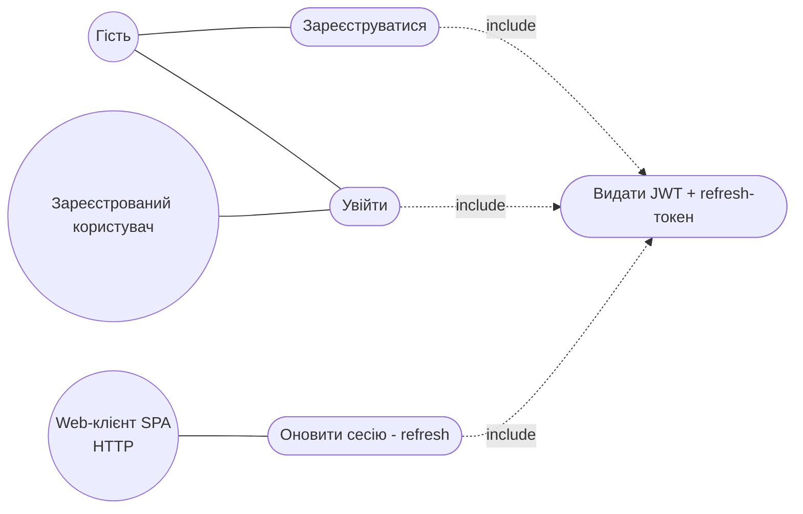

# ЛР-9. SQALE, фінансова капіталізація технічного боргу, FPA & UCP

## Що автоматизовано і що треба запустити

| Завдання | Артефакт | Статус |
|----------|----------|--------|
| 1. SQALE через SonarCloud API | [`.github/workflows/sqale-audit.yml`](../../../.github/workflows/sqale-audit.yml), [`scripts/quality/sqale_audit.py`](../../../scripts/quality/sqale_audit.py) | **Запустити:** вибрати OSS-проєкт, Actions → «SQALE audit & financial ledger» → ввести project key |
| 2. Фінансовий симулятор | [`scripts/quality/financial_simulator.py`](../../../scripts/quality/financial_simulator.py), тести [`scripts/quality/tests/test_lab09.py`](../../../scripts/quality/tests/test_lab09.py) | Готово й протестовано; `FINANCIAL_LEDGER.md` з'явиться в корені після запуску workflow |
| 3. FPA + UCP + калібрування | цей звіт, [`scripts/quality/git_effort.py`](../../../scripts/quality/git_effort.py) | Готово на модулі автентифікації ZVYTIAHA |

SonarCloud із середовища, де це писалось, був недоступний, тому цифри SQALE тут **не наведено і не вигадано**. Їх дає workflow із реального API.

## Завдання 1. Forensic-аудит SQALE

### Як вибрати об'єкт

1. Відкрити https://sonarcloud.io/explore/projects, фільтр Language → C# (або свій стек), сортування за розміром.
2. Взяти активний проєкт з **ncloc ≥ 50 000**; project key — частина URL після `?id=`.
3. Actions → **SQALE audit & financial ledger** → Run workflow → `project_key`, `hourly_rate` (35–50).

### Протокол хмарного виклику (виконує workflow)

```bash
curl "https://sonarcloud.io/api/measures/component?component=<project_key>&metricKeys=sqale_index,ncloc,sqale_rating"
```

Сира відповідь зберігається в `docs/quality-labs/lab09/audit/report.json`, текст запиту й HTTP-код — у `request.log`. Обидва файли комітяться в гілку й лежать в артефакті.

### Математика (`sqale_audit.py`, результат — `audit/SQALE_AUDIT.md`)

| Величина | Формула |
|----------|---------|
| Борг, людино-годин | sqale_index / 60 |
| Борг, робочих днів | години / 8 |
| Обсяг системи, год | ncloc × 30 хв / 60 = ncloc × 0.5 |
| TDD, % | борг у годинах / (ncloc × 0.5) × 100 |
| Рейтинг | A ≤ 5%, B ≤ 10%, C ≤ 20%, D ≤ 50%, E > 50%; `sqale_rating` з API: 1.0 = A … 5.0 = E |

Скрипт сам звіряє розрахований рейтинг з `sqale_rating` із JSON і пише вердикт «збігається / не збігається».

> **Картка об'єкта аудиту** (назва, призначення, репозиторій, key) і таблиця SQALE Audit Ledger заповнюються з `audit/SQALE_AUDIT.md` після запуску.

## Завдання 2. Software Economics і Financial Quality Ledger

Скрипт [`financial_simulator.py`](../../../scripts/quality/financial_simulator.py) читає `sqale_index` і `ncloc` **з `report.json`** (нічого не вшито в код) та змінні оточення:

| Змінна | Значення | Перевірка |
|--------|----------|-----------|
| `HOURLY_RATE` | 40 (workflow input) | діапазон 35–50, інакше помилка |
| `OVERLOAD_COEFF` | 1.3 | ≥ 1.0 |
| `DISCOUNT_RATE` | 0.01 (1%/міс) | 0..1 |

Модель:

```
Тіло боргу      = sqale_index / 60 × HOURLY_RATE × OVERLOAD_COEFF
Cost of Delay   = ncloc / 100 × HOURLY_RATE                      (за місяць)
NPV_t           = Σ(k=1..t) CoD / (1 + DISCOUNT_RATE)^k − Тіло боргу,   t = 1..6
Payback         = перший t, де NPV_t > 0;  Quality Gate = PASS, якщо payback ≤ 6, інакше FAIL
```

Ядро циклу:

```python
for t in range(1, HORIZON_MONTHS + 1):
    factor = 1 / (1 + discount_rate) ** t
    benefit = cost_of_delay * factor
    cumulative += benefit
    npv = cumulative - principal
    months.append(Month(t, factor, benefit, npv))
    if npv > 0 and payback is None:
        payback = t
```

`FINANCIAL_LEDGER.md` має п'ять розділів за прикладом з методички: вхідні параметри; тіло боргу і CoD; таблиця «місяць / коефіцієнт дисконтування / дисконтований прибуток / кумулятивний NPV»; вердикт про точку окупності; статус воріт якості PASS/FAIL.

**Тести формул** (синтетичні дані, очікування пораховано вручну): ncloc = 60 000, sqale_index = 120 000 хв, ставка $40, коеф. 1.3, 1%/міс → тіло боргу $104 000, CoD $24 000/міс, NPV₄ < 0, NPV₅ > 0, окупність на 5-му місяці, PASS; для боргу 1 000 000 хв — FAIL. Плюс TDD = 6.67% → B. Усі 6 тестів проходять (`python -m unittest discover -s scripts/quality/tests`); workflow запускає їх перед розрахунком.

> **Додати:** скриншот консолі з кроку «Financial simulation» (або `simulator-console.log` з артефакту) і лістинг згенерованого `FINANCIAL_LEDGER.md`.

### Аналітичний висновок щодо Software Economics

Обидві сторони рівняння пропорційні розміру системи. CoD росте лінійно з ncloc (1 год/міс на 100 рядків), а тіло боргу — з sqale_index, тобто з **щільністю** боргу (TDD) × розмір. Тому окупність визначає саме щільність, а не абсолютний розмір: великий проєкт з TDD 2–5% окупає рефакторинг за 1–3 місяці, бо щомісячні втрати вже величезні. А проєкт із TDD > 20% (рейтинг D/E) за 6 місяців не виходить у плюс, і борг треба гасити поетапно, починаючи з Hotspots (ЛР-7), де CoD найвищий.

## Завдання 3. FPA (IFPUG) і UCP (Карнер) для модуля автентифікації

**Об'єкт.** Методичка вимагає модуль з OSS-проєкту із Завдання 1. Цей модуль ще не вибрано (див. вище), тож вимірювання виконано на реальному модулі власного проєкту: автентифікації ZVYTIAHA. Тут є і код, і повна Git-історія для калібрування. Ту саму методику без змін можна застосувати до модуля OSS-проєкту.

### Специфікація реверс-інжинірингу (джерела даних)

| Категорія | Джерело в коді |
|-----------|----------------|
| Дані (ORM) | `Infrastructure/Entities/User.cs` (14 властивостей), `UserDetail.cs` (7), `UserPhone.cs` (5), `RefreshToken.cs` (8), `AccountState.cs` (5) |
| Транзакції | `AuthController`: `POST /api/v1/auth/register`, `POST /api/v1/auth/login`, `POST /api/v1/auth/refresh`, `GET /api/v1/users/me`; контракт `IAuthenticationService.RegisterAsync / LoginAsync / RefreshAsync` |
| Вхідні DTO | `RegisterUserRequest` (Email, Password, FullName, PhoneNumber, DateOfBirth, Role), `LoginRequestDto` (Email, Password, RememberMe) |
| Трудовитрати | Git-історія 17 шляхів модуля (бекенд + клієнтські форми), до 01.11.2026 |

**Знахідка:** `GET /api/v1/users/me` повертає заглушку (`Guid.NewGuid()`, `player@example.com`, `Sample Player`) і не читає даних користувача. Бізнес-функції вона не надає, тож у FPA/UCP **не врахована**. Це технічний борг, який треба виправити.

### UML Use Case діаграма



> Для звіту можна перемалювати цю схему в Draw.io як класичну UML Use Case діаграму.

### FPA калькулятор (IFPUG Ledger)

Матриці складності IFPUG: ILF/EIF — за RET × DET, EI — за FTR × DET.

| # | Елемент | Тип | RET/FTR | DET | Складність | Вага |
|---|---------|-----|--------:|----:|------------|-----:|
| 1 | Обліковий запис користувача (User + UserDetail + UserPhone) | ILF | 3 RET | 12 | Low | 7 |
| 2 | Сесії refresh-токенів (RefreshToken) | ILF | 1 RET | 7 | Low | 7 |
| 3 | Стани облікових записів (AccountState, лише читання) | EIF | 1 RET | 4 | Low | 5 |
| 4 | Реєстрація | EI | 3 FTR (акаунт, стани, токени) | 7 | High | 6 |
| 5 | Вхід | EI | 3 FTR (акаунт, стани, токени) | 4 | Average | 4 |
| 6 | Оновлення сесії (refresh) | EI | 2 FTR (токени, акаунт) | 3 | Low | 3 |
| | **Нескоригований розмір (UFP)** | | | | | **32** |

DET обліку: 12 користувацьких атрибутів (Id, ПІБ, хеш пароля, роль, стан, email, дата народження, прапорець налаштувань, телефон, 3 часові мітки). Транзакції: вхідні поля + повідомлення / дія. EO і EQ у модулі немає: власних звітів чи обчислювальних виходів він не має, а єдиний запит `/users/me` — заглушка. VAF прийнято 1.0, тож **FP = 32**.

### UCP матриця Карнера

| Актор | Тип | Вага |
|-------|-----|-----:|
| Гість | Людина через GUI (складний) | 3 |
| Зареєстрований користувач | Людина через GUI (складний) | 3 |
| Web-клієнт SPA (axios-перехоплювач, автоматичний refresh) | Система через HTTP (середній) | 2 |
| **UAW** | | **8** |

| Use Case | Транзакції (кроки логіки з коду) | Кількість | Клас | Вага |
|----------|-----------------------------------|----------:|------|-----:|
| Зареєструватися | обов'язкові поля → унікальність email → політика пароля → вік ≥ 13 → формат телефону → створення користувача в транзакції → видача й збереження токенів → commit/rollback | 8 | Складний (> 7) | 15 |
| Увійти | валідація → перевірка блокування → пошук користувача → перевірка пароля (з лічильником невдач) → активність акаунта → видача/відкликання токенів → відповідь | 7 | Середній (4–7) | 10 |
| Оновити сесію | наявність токенів → перевірка підпису access-токена → claims (`jti`, `sub`) → перевірка refresh-токена → відновлення ролі/email → видача й збереження нових токенів | 6 | Середній | 10 |
| **UUCW** | | | | **35** |

UUCP = UAW + UUCW = 8 + 35 = **43**; TCF = ECF = 1.0 → **UCP = 43 × 1.0 × 1.0 = 43**.

### Зворотне калібрування

Трудовитрати з Git ([evidence/git-effort-auth.txt](evidence/git-effort-auth.txt)), метод «git-hours»: коміти одного автора з інтервалом ≤ 2 год вважаються однією сесією, і до першого коміту сесії додається 1 год.

| Автор | Коміти | Сесії | Людино-годин |
|-------|-------:|------:|-------------:|
| Serhii Skurtul | 25 | 18 | 21.3 |
| LYarmoliuk | 21 | 17 | 18.5 |
| Volodymyr Dudko | 2 | 2 | 2.0 |
| **Разом** | **48** | | **41.8** |

**PF = 41.8 людино-год / 43 UCP ≈ 0.97 год/UCP.** Чутливість: якщо зарахувати 2 год до першого коміту, виходить 78.8 год і **PF ≈ 1.83 год/UCP**.

Інтерпретація. Значення суттєво нижче за класичний орієнтир Карнера (≈ 20 год/UCP), і це очікувано. Git-hours бачить лише активне кодування між комітами. Аналіз вимог, дизайн, рев'ю, налагодження без комітів і зустрічі в нього не потрапляють, а частину модуля створено за шаблоном ASP.NET Identity-подібних рішень. Тому 0.97–1.83 год/UCP — це **нижня межа «чистого кодування»** цієї команди.

### Як PF допоможе з Change Requests

Новий запит оцінюється до написання коду: описати його як use cases, порахувати UCP за тими самими правилами, помножити на PF. Наприклад, «вхід через Google OAuth» ≈ 1 складний use case (15) + новий системний актор (1) = 16 UCP. Це ≈ 15–30 год чистого кодування за нашим PF, а з повним циклом (за орієнтиром Карнера) — до ~320 год. Щоб стиснути цей діапазон, PF треба перекалібровувати після кожного спринту на реальних worklog-ах (Jira) замість git-hours. Тоді компанія даватиме замовнику бюджет у межах ±20%, а не «на око».

## Лог валідації ШІ-Техліда

> Розділ має містити реальний протокол твого діалогу з ШІ-Техлідом за інструкцією курсу. Його не згенеровано.

## Нотатки до захисту

- **Cost of Delay** — скільки грошей бізнес втрачає щомісяця, поки борг не виправлено (час на регресійні баги). Рефакторинг — це інвестиція, а CoD — її щомісячна віддача, тому NPV рахує, коли сума дисконтованих віддач перекриє вартість рефакторингу.
- **FPA і UCP.** FPA міряє функціональність через дані й транзакції (ILF/EIF/EI/EO/EQ) з погляду користувача і не залежить від мови. UCP міряє через акторів і сценарії use case. FPA точніший для даних-орієнтованих систем, UCP легше отримати з вимог на ранній стадії.
- **TDD** — щільність боргу: яку частку часу написання системи з нуля зайняло б виправлення боргу.
