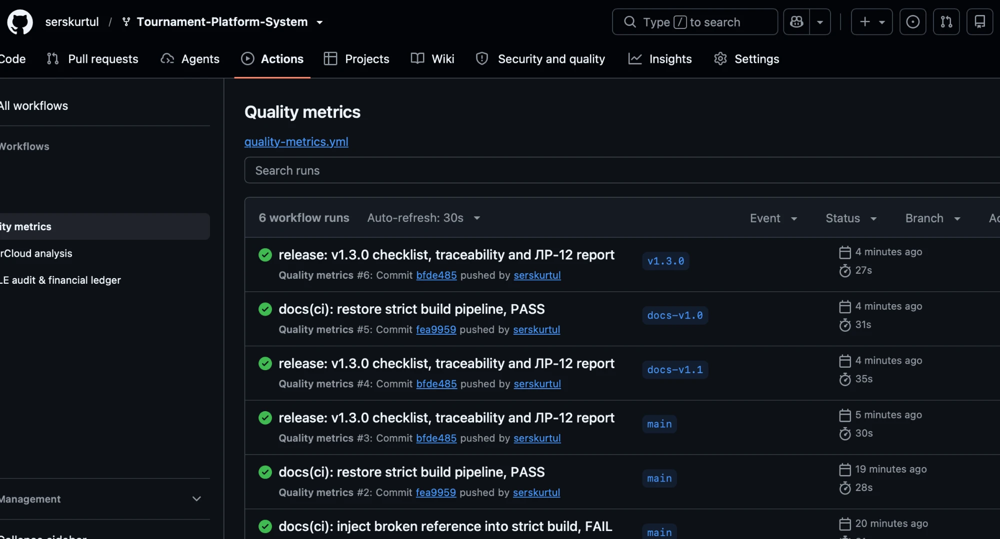
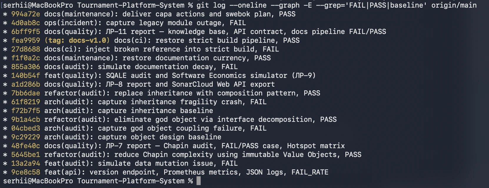

# ЛР-10. Аудит документації, архітектурний паспорт (SDD, ISD, ADR), супровід і Handover

Інструменти: [`scripts/quality/doc_audit.py`](../../../scripts/quality/doc_audit.py) (метрики актуальності з Git) і [`scripts/quality/doc_contract_check.py`](../../../scripts/quality/doc_contract_check.py) (документи ↔ код, CI-джоба `doc-contract`).

## Завдання 1. Інвентаризаційний аудит

### Інвентаризаційний реєстр

| Документ | Розташування | Тип | Категорія | Аудиторія | Власник | Чого не покриває |
|----------|--------------|-----|-----------|-----------|---------|------------------|
| README | `README.md` | продукт | експлуатаційна | новачок, бізнес, DevOps | PM | (до паспорта) карту компонентів, k8s/Helm, документацію |
| Contributors | `CONTRIBUTORS.md` | процес | — | команда | PM | ролі (дублює розділ README «Команда») |
| Client README | `client/README.md` | продукт | технічна | розробники фронтенду | Frontend | нічого про проєкт — шаблон Vite |
| ADR System Style | `docs/ADR_System_Style.md` | процес | архітектурна | розробники | Backend | наступні рішення (немає журналу) |
| SAD Internal View | `docs/SAD_Internal_View.md` | продукт | архітектурна | розробники | Backend | поточну структуру (до ЛР-8) |
| Data Dictionary | `docs/DATA_DICTIONARY.md` | продукт | технічна | розробники, QA | DB | — |
| Data Integrity | `docs/Storage/Data_Integrity.md` | продукт | технічна | розробники | DB | резервне копіювання |
| Data Flow Spec | `docs/Data_Flow_Specification.md` | продукт | архітектурна | розробники, QA | Backend | ендпоінти після квітня |
| Error Catalog | `docs/ErrorCatalog.md` | продукт | технічна | розробники, QA | Backend | нові сервіси |
| Naming Conventions | `docs/NAMING_CONVENTIONS.md` | процес | технічна | розробники | команда | — |
| Test Plan | `docs/TestPlan.md` | процес | технічна | QA | QA | інтеграційні тести, CI-кроки |
| User Guide (PDF) | `docs/Tournament_Platform_System__User_Guide.pdf` | продукт | технічна | бізнес, користувачі | PM | — (бінарний, Git-метрики неінформативні) |
| k8s README, Helm README | `k8s/`, `charts/…/` | продукт | експлуатаційна | DevOps | Backend/DevOps | — |
| Лаб-runbook | `docs/labs/README.md`, `docs/quality-labs/*` | процес | експлуатаційна | DevOps, викладач | автор лаб | — |
| CI/CD-конфігурації | `.github/workflows/*.yml` | продукт | експлуатаційна | DevOps | Backend/DevOps | людського опису (до ISD) |
| Шаблон PR | `.github/PULL_REQUEST_TEMPLATE.md` | процес | — | розробники | PM | правило оновлення документації (додано) |
| Swagger-анотації | контролери | продукт | технічна | розробники, QA, клієнти | Backend | — |
| Повідомлення комітів | Git | процес | — | розробники | усі | — |

### Лог метрик актуальності

Повний вивід: [evidence/01-doc-audit-before.md](evidence/01-doc-audit-before.md) (стан до паспорта), команди: [evidence/02-git-cli-commands.txt](evidence/02-git-cli-commands.txt).

```bash
git log -1 --format=%cs -- docs/SAD_Internal_View.md           # 2026-03-30
git rev-list --count <останній коміт SAD>..HEAD -- server       # 119 змін коду після оновлення
git log --oneline -- docs/SAD_Internal_View.md | wc -l          # 1 коміт документа за весь час
```

| Документ | Вік, дн | Змін коду після оновлення | Сигнали |
|----------|--------:|--------------------------:|---------|
| `docs/SAD_Internal_View.md` | 236 | 119 | stale > 180, drift > 20 |
| `docs/Data_Flow_Specification.md` | 229 | 98 | stale, drift |
| `client/README.md` | 232 | 85 | stale, drift |
| `docs/TestPlan.md` | 228 | 24 | stale, drift |
| `docs/ADR_System_Style.md` | 236 | 119 | stale, drift (запис процесу) |
| `README.md` | 155 | 14 | suspicious > 90 |
| `docs/DATA_DICTIONARY.md`, `docs/Storage/Data_Integrity.md` | 163 | 1 | suspicious > 90 |
| `docs/ErrorCatalog.md` | 171 | 2 | suspicious > 90 (але див. нижче) |
| `k8s/README.md`, Helm README | 15 | 0 | ok |

**Свідчення використання.** Чатів і задач команди в репозиторії немає, тож проксі — вхідні посилання з інших документів і коду. Нуль посилань мали `SAD_Internal_View`, `Data_Flow_Specification`, `ErrorCatalog`, `TestPlan`, `CONTRIBUTORS`, `ADR_System_Style`.

### Діагноз антипатернів

- **Documentation Decay:** `SAD_Internal_View.md` і `ErrorCatalog.md` описують єдиний `TournamentService`, якого після ЛР-8 не існує. Error Catalog за лічильником «свіжий» (лише 2 зміни у винятках і middleware після оновлення), але за змістом уже застарів. Отже, метрики Git необхідні, але недостатні: потрібна ще перевірка змісту (тому з'явився `doc_contract_check`). `Data_Flow_Specification` (98 змін коду) і `TestPlan` (24 зміни тестів) — структурний дрейф.
- **Dead Documentation:** `client/README.md` (шаблонний текст Vite, 0 інформації про проєкт); `CONTRIBUTORS.md` (без вхідних посилань, дублює README).

### Матриця вердиктів

| Документ | Вердикт | Виконано |
|----------|---------|----------|
| README | оновити | ✅ призначення, онбординг, карта документації, структура |
| client/README | оновити (переписати) | ✅ |
| ErrorCatalog | оновити | ✅ посилання на нові сервіси |
| SAD_Internal_View | deprecated (замінено SDD) | ✅ банер із посиланням на SDD |
| Data_Flow_Specification, TestPlan, DATA_DICTIONARY | оновити | заплановано в регламенті (прострочено, власники призначені) |
| CONTRIBUTORS | видалити (дублює README) | залишено до рішення команди |
| ADR_System_Style, NAMING_CONVENTIONS, звіти лаб | зберегти як записи процесу | — |

## Завдання 2. Архітектурний паспорт

- **SDD** — [docs/sdd.md](../../architecture/sdd.md): C4-діаграма контейнерів (Mermaid `C4Container`), 15 компонентів з відповідальністю, залежностями й посиланням на ISD, ER-модель (Mermaid `erDiagram`), 25 API-контрактів.
- **ISD** — [docs/isd.md](../../architecture/isd.md): 5 середовищ, топологія (compose / Kubernetes / GitOps), порядок старту, змінні без секретів, сховища, 4 CI/CD-конвеєри з Quality Gates, моніторинг, резервне копіювання з **RTO ≤ 1 год і RPO ≤ 24 год**. Прогалина (дамп не за розкладом) чесно зафіксована.
- **ADR** — [docs/architecture/adr/](../../architecture/adr/README.md): ADR-0001 (PostgreSQL + EF Core; оформлено ретроспективно, про що сказано в записі) і ADR-0002 (декомпозиція `TournamentService`). У кожному — контекст, таблиця альтернатив, рішення, наслідки.

### Матриця покриття аудиторій

| Аудиторія | Ключові питання | Документ-відповідь | Статус |
|-----------|-----------------|--------------------|--------|
| Новачок | Як запустити локально? З чого почати? | README → «Шлях новачка», «Кроки запуску»; [handover §2](../../developer/handover.md) | покрито (закрито в README) |
| Розробник | З якими компонентами взаємодіє мій модуль? Чому так зроблено? | SDD §2 (таблиця залежностей), ADR | покрито |
| QA | Де контракти поведінки? Які помилки повертає API? | SDD §4, Swagger, ErrorCatalog, TestPlan | покрито (TestPlan — у плані оновлення) |
| DevOps | Як розгорнути й відкотити реліз? Який порядок старту? Як відновитись? | ISD §2, §5, §6; k8s/Helm README | покрито |
| Бізнес | Що система робить і для кого? | README («Для кого», Features) | покрито (закрито в README) |

Коміт: `docs(architecture): deliver design and infrastructure passport`.

## Завдання 3. Супровід документації

### Регламент

[docs/maintenance.md](../../developer/maintenance.md): власник і цикл (90 днів для експлуатаційних, 180 для архітектурних) для кожного документа, дата перегляду, прострочені позиції. Правило «зміна коду = зміна документації» закріплене: джоба `doc-contract` у `quality-metrics.yml` (падає, якщо маршрут не в SDD або порядок старту не збігається з ISD) і чекбокс у шаблоні PR.



*Actions → Quality metrics (містить джобу `doc-contract`): зелені прогони після відновлення документації.*

### Краш-тест Documentation Decay (FAIL)

Git-diff контрольованої зміни (коміт `docs(audit): simulate documentation decay, FAIL`):

```diff
 # docker-compose.yml
+    healthcheck:
+      test: ["CMD", "curl", "-fsS", "http://localhost/version"]
     ...
     depends_on:
-      - app
+      app:
+        condition: service_healthy

 # TournamentsController.cs
+        [HttpGet("{id}/participants/count")]
+        [AllowAnonymous]
+        public async Task<IActionResult> GetActiveParticipantsCount(Guid id, [FromServices] IParticipantRoster roster)
```

Доказ дрейфу ([evidence/03-fail-contract-check.txt](evidence/03-fail-contract-check.txt)):

```
routes in code: 25, documented: 24; compose dependencies: 5, documented: 5
DRIFT  SDD: routes in code but not documented:          GET /api/v1/tournaments/{id}/participants/count
DRIFT  ISD: start-up dependencies in compose but not documented:   client -> app (service_healthy)
DRIFT  ISD: documented dependencies that no longer exist:          client -> app (service_started)
RESULT: FAIL (documentation drift)
```

| Аудиторія | Що «бреше» |
|-----------|-----------|
| Новачок, бізнес | README не знає про публічний лічильник учасників і обіцяє, що UI з'являється одразу, хоча тепер він чекає на healthcheck API |
| Розробники, QA | SDD не містить нового контракту, а QA не має що перевіряти за документом (structure drift) |
| DevOps | ISD каже `client -> app (service_started)`, а фактично `service_healthy` з healthcheck; порядок підняття змінено |

Метрики після FAIL ([evidence/04-doc-audit-after-fail.md](evidence/04-doc-audit-after-fail.md)): у README і SDD з'явилась 1, а в ISD 2 зміни коду після останнього оновлення документа (до цього — 0).

### Відновлення (PASS)

Коміт `docs(maintenance): restore documentation currency, PASS` оновлює README (лічильник, затримка старту UI), SDD (новий контракт і відповідальність ParticipantService) і ISD (`client -> app (service_healthy)`, healthcheck API). Перевірка ([evidence/05-pass-contract-check.txt](evidence/05-pass-contract-check.txt)): `routes in code: 25, documented: 25 … RESULT: PASS`. Метрики ([evidence/06-doc-audit-after-pass.md](evidence/06-doc-audit-after-pass.md)): README, SDD і ISD знову мають 0 неврахованих змін коду, битих посилань 0, матриця аудиторій без прогалин.

| Метрика | До паспорта | Після FAIL | Після PASS |
|---------|-------------|------------|------------|
| Контракти SDD ↔ код | — (SDD не було) | 24 / 25 | 25 / 25 |
| Порядок старту ISD ↔ compose | — | 4 / 5 | 5 / 5 |
| Змін коду після оновлення README / SDD / ISD | 14 / — / — | 1 / 1 / 2 | 0 / 0 / 0 |



*Дерево комітів: `855a306 docs(audit): simulate documentation decay, FAIL` → `f1f0a2c docs(maintenance): restore documentation currency, PASS`.*

### Handover-пакет

[docs/handover.md](../../developer/handover.md): реєстр документів з власниками і статусом актуальності, онбординг у 5 кроків, декларація Bus Factor (`git blame -w -M -C` на `6bb342a`, [evidence/07-bus-factor-git-blame.txt](evidence/07-bus-factor-git-blame.txt)): **Bus Factor = 1 у всіх 9 компонентах** (бекенд 85–100% — Скуртул С., фронтенд 100% — Ярмолюк Л., схема БД 85% — Дудко В.). До кожного компонента додано план парного володіння. Вердикт: система **ще не** «Always Ready to Handover»: Bus Factor = 1, частина документів прострочена, резервного копіювання за розкладом немає.

## Лог валідації ШІ-Техліда

> Розділ має містити реальний протокол твого діалогу з ШІ-Техлідом за інструкцією курсу. Його не згенеровано.

## Нотатки до захисту

- **Документація продукту і процесу.** Документація продукту «жива» і змінюється разом із системою (README, SDD, ISD, Swagger). Документація процесу — історичний запис факту в часі (звіти, протоколи, ADR, коміти): її не переписують, лише позначають застарілою.
- **SDD і ISD.** SDD — як система влаштована всередині (компоненти, дані, API). ISD — де і як вона працює (середовища, розгортання, CI/CD, моніторинг, відновлення).
- **Чому застаріла документація гірша за відсутню:** вона створює ілюзію розуміння, і людина діє впевнено, але неправильно (наприклад, чекає UI одразу після старту API).
