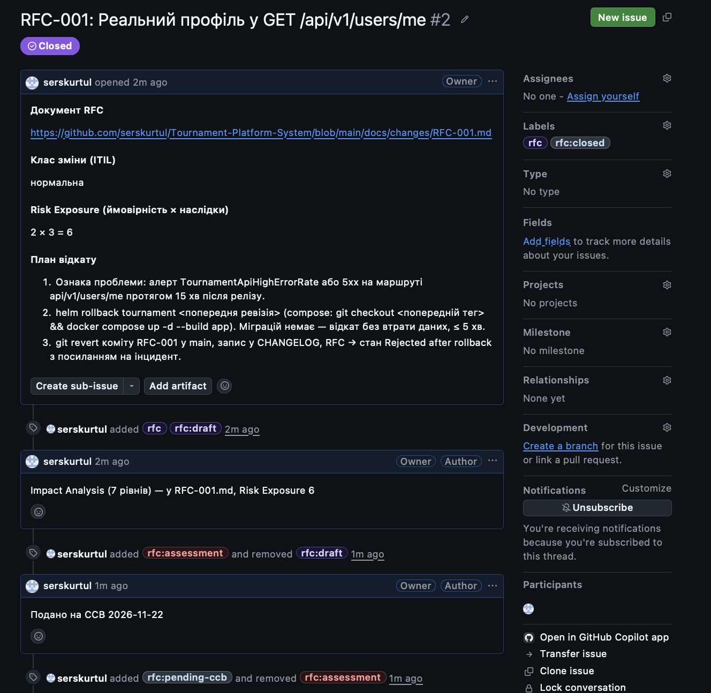
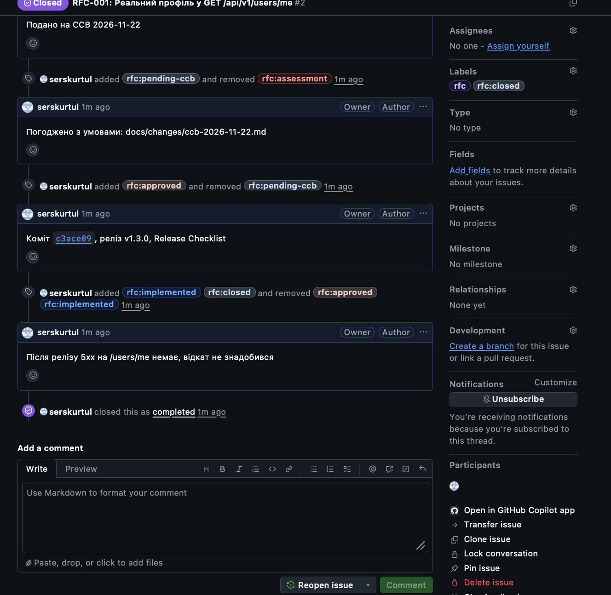
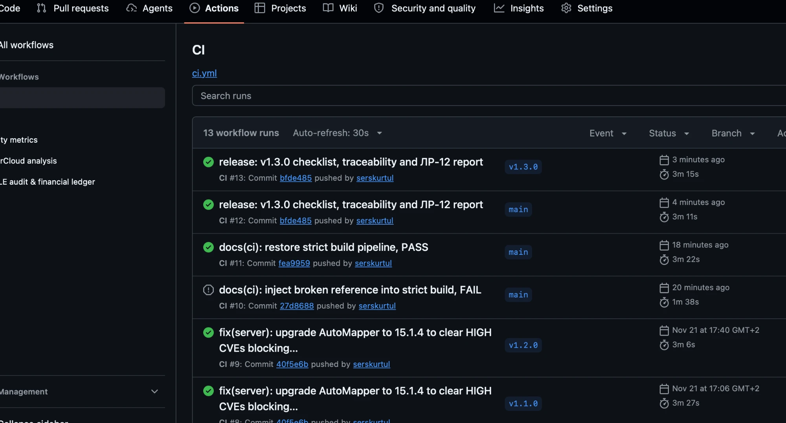
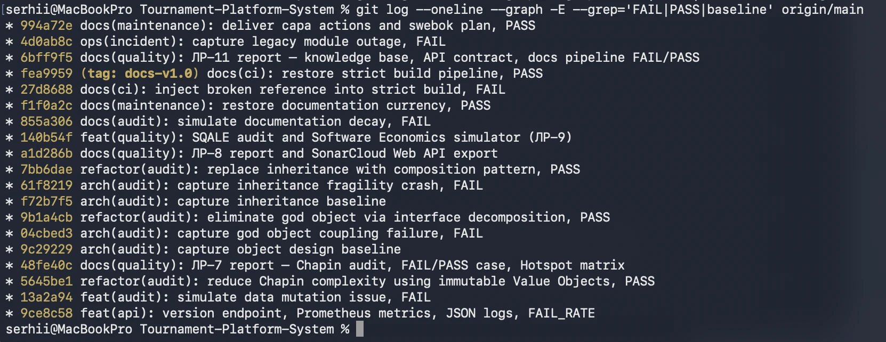

# ЛР-12. Супровід і експлуатація: runbooks, SLA/SLO/SLI, RFC/CCB, інцидент і CAPA

Проєкт: ZVYTIAHA. Дата: 2026-11-22. Усі часи — UTC. Докази — у `evidence/`.

**[ДЛЯ СТУДЕНТА]** — кроки, що потребують твого акаунта, кластера або GUI.

## Завдання 1. Експлуатаційний пакет SRE

| Артефакт | Файл |
|----------|------|
| Runbook відновлення БД (усі канонічні розділи, рівень автоматизації 1 з обґрунтуванням) | [`docs/runbooks/RB-001.md`](../../runbooks/RB-001.md) |
| Каталог алертів: 5 алертів «Назва / Умова / Серйозність / Роль / Runbook» | [`docs/runbooks/alerts.md`](../../runbooks/alerts.md) ↔ `charts/…/prometheusrule.yaml` (`runbook_url` у кожному) |
| Розгортання, оновлення з міграціями, порядок відновлення (БД → міграції → API → клієнт), RTO/RPO з розрахунком, backup policy 3-2-1, restore drill | [ISD §7](../../architecture/isd.md#7-експлуатаційні-процедури) |
| Автоматизація бекапу | Helm CronJob `db-backup` (щодня 02:15 UTC, 14 днів), `scripts/ops/backup_db.sh` / `restore_db.sh` |
| SLO як код | [`docs/slo.yaml`](../../slo.yaml), `scripts/ops/error_budget.py` |

**Restore drill виконано по-справжньому** (`evidence/restore-drill.txt`):

1. Зашифрована (AES256) копія, sha256 OK.
2. Відновлення в `tournament_drill` за 2 с; кількість рядків 12/12 таблиць збігається з маніфестом.
3. Захист від перезапису робочої бази без `CONFIRM=yes` спрацював (exit 2).
4. Скрипт CronJob із чарту, запущений в образі `postgres:15` проти живої БД, створив дамп і видалив 20-денний файл (ротація).

**SLI / SLO / SLA і Error Budget** (вікно 30 днів = 43 200 хв):

| SLI | Інженерне визначення | SLO | SLA | Буфер | Бюджет SLO | Бюджет SLA |
|-----|---------------------|-----|-----|-------|-----------|-----------|
| availability | частка запитів (крім health/version/metrics) зі статусом ≠ 5xx | 99,5% | 99,0% | 0,5 п.п. | **216 хв** | 432 хв |
| latency | частка запитів ≤ 320 мс (бакет `le="0.32"`) | 95,0% | 90,0% | 5 п.п. | **2 160 хв** | 4 320 хв |
| banner-upload | частка `POST …/{id}/image` зі статусом ≠ 5xx | 99,0% | 97,0% | 2 п.п. | **432 хв** | 1 296 хв |

Формула: (100% − SLO) × 43 200 хв; наприклад, (100 − 99,5)% × 43 200 = 216 хв. SLA навмисно м'якший за SLO: різниця — буфер, у межах якого команда реагує до порушення зобов'язань перед клієнтом. Для SLI на основі запитів хвилини — еквівалент повного простою за рівномірного трафіку.

Error budget policy (у `slo.yaml`): < 50% — звичайний режим; 50–75% — ризикові зміни лише з перевіреним відкатом; 75–100% — тільки стандартні зміни й надійність; ≥ 100% — **change freeze** (лише надійність, CAPA, emergency RFC). Це узгоджено з регламентом CCB.

## Завдання 2. Управління змінами

| Артефакт | Файл |
|----------|------|
| Регламент: ланцюг станів (діаграма), класи ITIL, Risk Exposure, склад/кворум/періодичність CCB, change freeze | [`docs/changes/index.md`](../../changes/index.md) |
| RFC-001 «реальний профіль у `/users/me`»: форма, 7 рівнів Impact Analysis з файлами/ендпоінтами/тестами, Risk Exposure 2 × 3 = 6, план відкату | [`RFC-001.md`](../../changes/RFC-001.md) |
| Протокол CCB: 4 ролі, аргументи кожної, «погоджено з умовами» | [`ccb-2026-11-22.md`](../../changes/ccb-2026-11-22.md) |
| Release Checklist go/no-go і ланцюг простежуваності вимога → RFC → коміт → тести → CHANGELOG → тег → образ | [`release-checklist.md`](../../changes/release-checklist.md), `evidence/release-v1.3.0-checks.txt` |
| Шаблон заявки для трекера | `.github/ISSUE_TEMPLATE/rfc.yml` (мітки `rfc:<стан>`) |

RFC-001 реально реалізовано за умовами CCB (коміт `c3ace09`):

- профіль власника токена + 401/404;
- 3 юніт-тести;
- контракт 1.2.0 (additive);
- контрактний тест 5/5;
- CHANGELOG і SDD оновлено;
- на живому API `/users/me` повертає профіль тестового користувача, без токена — 401.

CCB — умовне засідання, усі ролі виконує один студент (дозволено методичкою); у протоколі це зазначено.

Заявку зареєстровано в трекері (GitHub Issues, шаблон `rfc.yml`) і проведено ланцюгом станів:

*Issue #2 «RFC-001»: документ RFC, клас ITIL «нормальна», Risk Exposure 2 × 3 = 6, план відкату; початок ланцюга `rfc:draft → rfc:assessment → rfc:pending-ccb`.*

*Продовження: `rfc:approved` (протокол CCB) → `rfc:implemented` (коміт `c3ace09`, реліз v1.3.0) → `rfc:closed`, Issue закрито як completed.*

Перша спроба (Issue #1) мала переплутаний порядок міток і закрита як дубль з посиланням на #2.

*Остання ланка простежуваності: CI #13 на тегу `v1.3.0` — зелений (тести, Trivy, публікація образів `:1.3.0`).*

**[ДЛЯ СТУДЕНТА]** (необов'язково): кроки 4 і 9 Release Checklist — розгортання на minikube і повідомлення користувачам; без них чек-лист лишається «GO з умовою».

## Завдання 3. Інцидент на legacy-модулі

### 3.1 Legacy-компонент

[`docs/architecture/legacy/storage-service.md`](../../architecture/legacy/storage-service.md) — сховище банерів (`GoogleDriveStorageService` → GCS). Документ містить:

- граф залежностей (Mermaid);
- формат конфігурації;
- ключові методи з рівнями довіри `verified` / `assumed`;
- реєстр техборгу з 9 пунктів (architecture / code / test / documentation).

### 3.2 Incident Report (FAIL)

Коміт `ops(incident): capture legacy module outage, FAIL` → [`INC-001.md`](../../incidents/INC-001.md). Сценарій — відкликаний ключ сервісного акаунта (`scripts/ops/simulate_storage_outage.sh`, тимчасовий ключ, якого Google не знає → `invalid_grant`).

Факти з прогону (`evidence/incident-simulation-FAIL.txt`, `incident-diagnosis.txt`, `incident-api-log.txt`, `incident-retry-409.txt`):

- 12/12 завантажень → 500 із внутрішнім текстом SDK;
- `/health` 200;
- агрегатний алерт **не спрацював** (5xx = 1,49% < 5%);
- **0** рядків Error у лозі;
- SLI `banner-upload` = 0% — порушення SLA 97%;
- повторна відправка форми → 409;
- виявлення ручне через 66 с, workaround через 81 с; SEV-3.

### 3.3 RCA

[`INC-001-postmortem.md`](../../incidents/INC-001-postmortem.md): blameless, «5 Чому» з доказом на кожному рівні.

Коренева причина процесна: **DoD і чек-лист PR не вимагали проєктувати, тестувати й спостерігати режими відмови зовнішніх залежностей**, а алерти будувалися від агрегатного SLO. Відкликаний ключ — лише тригер.

Діаграма Ісікави (Mermaid) має 6 категорій; підтверджені гіпотези відділено від assumed.

### 3.4 CAPA (PASS)

Коміт `docs(maintenance): deliver capa actions and swebok plan, PASS`.

| ID | Тип | Що зроблено | Перевірка ефективності |
|----|-----|-------------|------------------------|
| CA-1 | коригувальна | `StorageUnavailableException` → 503 без деталей SDK + `LogError` з `traceId`; клієнт не показує невдале створення, якщо впав лише банер; 2 тести | повтор симуляції тим самим ключем: 12/12 → 503, 12 Error-логів (`evidence/incident-simulation-PASS.txt`) |
| CA-2 | коригувальна | алерт `TournamentBannerUploadFailing` + RB-002 | на тих самих метриках: новий алерт FIRING, агрегатний — NOT FIRING |
| PA-1 | попереджувальна | чарт передає конфіг сховища (раніше в K8s upload падав **завжди** — латентний інцидент, знайдений RCA); пункт «зовнішня залежність» у DoD і PR-шаблоні | `helm template` рендерить змінні; аудит адаптерів до 2026-12-15 |

*Дерево комітів: `4d0ab8c ops(incident): capture legacy module outage, FAIL` → `994a72e docs(maintenance): deliver capa actions and swebok plan, PASS` (угорі).*

### 3.5 План супроводу

[`docs/maintenance-plan.md`](../../maintenance-plan.md):

- типи супроводу (ISO/IEC 14764);
- лінії L1/L2/L3 з критеріями передачі;
- матриця ескалації SEV-1…3 (час реакції, адресати, канали);
- Known Issues з обходами;
- пріоритети P1–P3 з прив'язкою до реєстру техборгу;
- посилання на runbook-и та `slo.yaml`.

Статус `in-review`: розподіл людей за лініями — пропозиція на основі Bus Factor ЛР-10, її погоджує команда.

## Що не зроблено або обмеження

- Кластера в пісочниці немає: CronJob, алерти й `storage.existingSecret` перевірено через `helm lint/template` і запуск скрипта CronJob в образі `postgres:15`, але не в Kubernetes.
- Offsite-копія (третя складова 3-2-1) потребує облікового запису хмарного сховища і описана політикою, а не налаштована (KI-4).
- Клієнтську зміну CA-1 перевірено збіркою й lint, але не наскрізним UI-тестом.
- Інцидент — симуляція на локальному стенді; хронологія — реальні часи прогону, без вигаданих подій. Повідомлення клієнтам не надсилались.
- «Лог валідації ШІ-Техліда» я не складав: це твій протокол взаємодії, і підробляти його я не буду.
