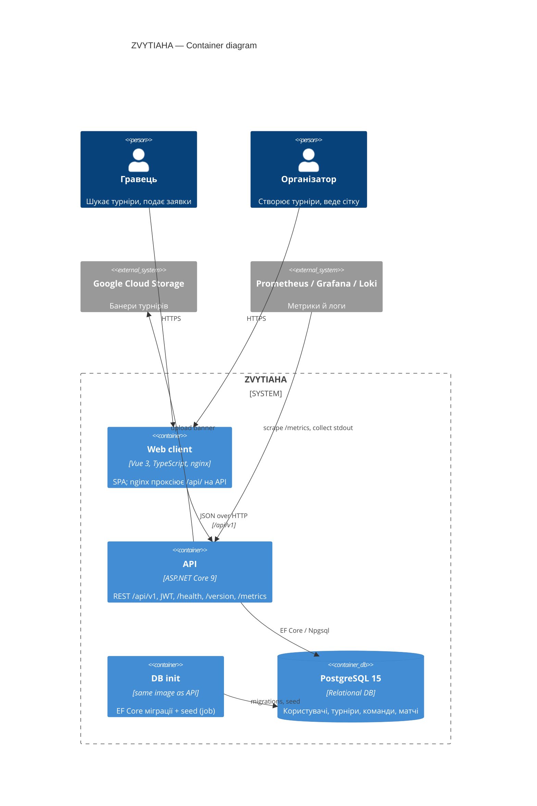
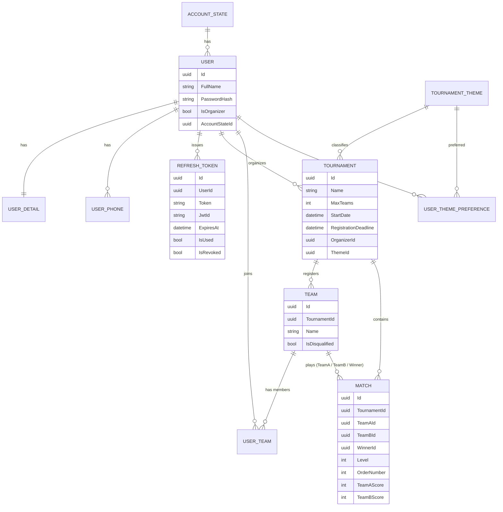

# System Design Document (SDD) — ZVYTIAHA

Що система робить: веб-платформа турнірів. Організатори створюють турніри, гравці реєструються на них, система будує сітку single elimination і фіксує результати матчів.
Як вона працює в середовищах розгортання, описано в [ISD](isd.md); чому прийнято саме такі рішення — в [ADR](architecture/adr/).

## 1. C4: контейнери

## 2. Компоненти

| Компонент | Відповідальність | Взаємодіє з | Розгортання |
|-----------|------------------|-------------|-------------|
| **Web client** (`client/`) | UI для гравців і організаторів, зберігання JWT, автоматичний refresh (axios-перехоплювач) | API через nginx `/api/` → `API_UPSTREAM` | [ISD §2](isd.md#2-топологія-розгортання) |
| **API: контролери** (`server/*.API/Controllers`) | HTTP-контракти (§4), авторизація за ролями `organizer` / `player` | сервіси нижче | [ISD §2](isd.md#2-топологія-розгортання) |
| `TournamentManagementService` | Створення, чернетка, редагування турніру, банер | `ITournamentRepository`, `IThemeRepository`, `IStorageService`, `IParticipantRoster` | у процесі API |
| `ParticipantService` (+ `IParticipantRoster`) | Додавання, видалення, дискваліфікація учасників; єдине джерело кількості активних учасників (також публічно через `GET …/participants/count`) | `ITournamentRepository`, `IUserRepository`, `TournamentdbContext`, `ITournamentStatusResolver` | у процесі API |
| `MatchService` | Старт турніру (генерація сітки), матчі, результати | `ITournamentRepository`, `TournamentdbContext`, `ITournamentStatusResolver`, `IParticipantRoster`, `IBracketGenerator`, `ISeedingStrategy` | у процесі API |
| `TournamentDetailsService` | Деталі турніру і таймлайн подій | `ITournamentStatusResolver`, `IParticipantRoster` | у процесі API |
| `TournamentCatalogService` | Списки, пошук, персоналізація за темами | `ITournamentRepository`, `TournamentdbContext` | у процесі API |
| `TournamentStatusResolver` | Завантажує турнір і закриває реєстрацію після дедлайну | `ITournamentRepository` | у процесі API |
| `AuthenticationService`, `JwtTokenService` | Реєстрація, вхід з обмеженням спроб, видача й оновлення JWT/refresh | `IUserRepository`, `IPasswordHasher`, `IMemoryCache` | у процесі API |
| `UserService`, `UserPreferencesService` | Пошук користувачів, онбординг і вподобання за видами спорту | `IUserRepository`, `TournamentdbContext` | у процесі API |
| **Репозиторії** (`*.Infrastructure/Repositories`) | Доступ до даних; загальний CRUD у `BaseRepository<TEntity,TDBEntity>` (композиція, не успадкування) | `TournamentdbContext`, AutoMapper | у процесі API |
| **Core** (`*.Core/Logic`) | Доменні алгоритми: `SingleEliminationBracketGenerator`, стратегії жеребкування, статуси матчів | без інфраструктурних залежностей | у процесі API |
| **Observability** (`*.API/Middleware`, `Observability/`) | JSON-логи в stdout, `http_requests_total` / `http_request_duration_seconds`, `FAIL_RATE` для демо | Prometheus, Loki | [ISD §6](isd.md#6-моніторинг-і-резервне-копіювання) |
| **DB init** | `dotnet ef database update` + `seeds/seed.sql` | PostgreSQL | [ISD §2](isd.md#2-топологія-розгортання) |
| **PostgreSQL** | Постійне сховище | — | [ISD §4](isd.md#4-сховища-даних) |

## 3. Модель даних (ER-фрагмент)

Повний словник полів: [DATA_DICTIONARY.md](DATA_DICTIONARY.md).

## 4. API-контракти (`/api/v1`, JSON)

Повна схема з прикладами — Swagger UI (`/swagger`).

| Контракт | Призначення | Доступ | Компонент |
|----------|-------------|--------|-----------|
| `POST /api/v1/auth/register` | Реєстрація (гравець / організатор) | анонімно | AuthenticationService |
| `POST /api/v1/auth/login` | Вхід, видача JWT + refresh-cookie | анонімно | AuthenticationService |
| `POST /api/v1/auth/refresh` | Оновлення пари токенів | refresh-cookie | AuthenticationService |
| `GET /api/v1/users/me` | Поточний користувач (**зараз повертає заглушку**, див. ЛР-9) | JWT | AuthController |
| `GET /api/v1/users` | Пошук користувачів | JWT | UserService |
| `GET /api/v1/users/me/onboarding-status` | Чи пройдено онбординг | JWT | UserPreferencesService |
| `PATCH /api/v1/users/me/onboarding-complete` | Позначити онбординг завершеним | JWT | UserPreferencesService |
| `PUT /api/v1/users/me/preferences` | Улюблені види спорту | JWT | UserPreferencesService |
| `GET /api/v1/sport` | Довідник видів спорту | анонімно | SportController |
| `GET /api/v1/tournaments` | Каталог з пошуком і пагінацією | анонімно / JWT | TournamentCatalogService |
| `GET /api/v1/tournaments/user` | Турніри користувача | JWT | TournamentCatalogService |
| `POST /api/v1/tournaments` | Створити турнір | organizer | TournamentManagementService |
| `POST /api/v1/tournaments/draft` | Зберегти чернетку | organizer | TournamentManagementService |
| `PATCH /api/v1/tournaments/{id}` | Редагувати турнір | organizer | TournamentManagementService |
| `POST /api/v1/tournaments/{id}/image` | Завантажити банер | organizer | TournamentManagementService |
| `GET /api/v1/tournaments/{id}` | Деталі турніру | анонімно | TournamentDetailsService |
| `GET /api/v1/tournaments/{id}/events` | Таймлайн подій | анонімно | TournamentDetailsService |
| `GET /api/v1/tournaments/{id}/participants` | Учасники | анонімно | ParticipantService |
| `GET /api/v1/tournaments/{id}/participants/count` | Кількість активних (недискваліфікованих) учасників | анонімно | IParticipantRoster (ParticipantService) |
| `POST /api/v1/tournaments/{id}/participants` | Подати заявку / додати гравця | JWT | ParticipantService |
| `DELETE /api/v1/tournaments/{id}/participants` | Скасувати власну участь | JWT | ParticipantService |
| `DELETE /api/v1/tournaments/{id}/participants/{userId}` | Дискваліфікувати учасника | organizer | ParticipantService |
| `POST /api/v1/tournaments/{id}/start` | Старт, генерація сітки | organizer | MatchService |
| `GET /api/v1/tournaments/{id}/matches` | Сітка матчів за раундами | анонімно | MatchService |
| `POST /api/v1/tournaments/{id}/matches/{matchId}/result` | Зберегти результат матчу | organizer | MatchService |

Службові ендпоінти поза `/api/v1`: `/health` (readiness, перевіряє БД), `/version` (liveness, версія збірки), `/metrics` (Prometheus).

Відповідність цієї таблиці коду перевіряє `python3 scripts/quality/doc_contract_check.py`.
